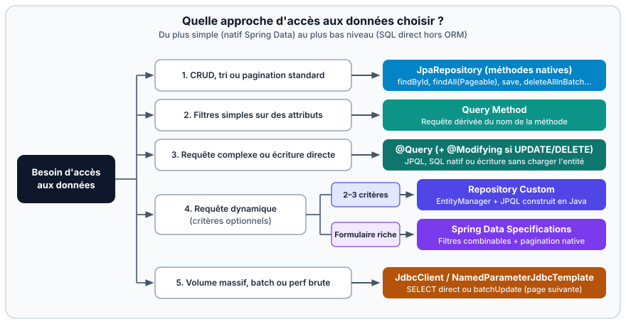
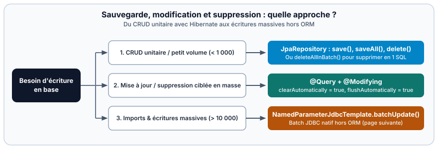

import { Steps } from '@astrojs/starlight/components';

## Méthodes fournies nativement par `JpaRepository`

:::note[Prérequis]
La déclaration de l'interface `JpaRepository<T, ID>` est présentée dans [Configuration de la BDD](/formation-api-rest/spring-boot/configuration-bdd/#création-du-repository-dao), et sa première utilisation dans un contrôleur REST dans [Création d'une API CRUD](/formation-api-rest/api-rest/creation-crud/).
:::

Avant d'écrire la moindre requête personnalisée, hériter de `JpaRepository<T, ID>` fournit un socle complet de méthodes prêtes à l'emploi (issues de `ListCrudRepository` et `ListPagingAndSortingRepository`) :

### Lecture & référence *lazy*

- **Requêtes immédiates (`SELECT`) :** `findById(id)` (`Optional<T>`), `findAll()`, `findAllById(ids)`, `findAll(Sort)`, `findAll(Pageable)` (`Page<T>`), `existsById(id)` et `count()`.
- **Référence sans requête (`getReferenceById(id)`) :** au lieu d'exécuter un `SELECT` immédiat comme le fait `findById`, Hibernate crée un objet factice (*proxy*) qui ne connaît que son `id`. Très utile lorsque l'appelant de l'API vous fournit déjà l'identifiant d'une entité liée (ex. `regionId` dans le JSON d'un `POST`) et que vous voulez rattacher la clé étrangère sans lecture inutile en base :
  ```java
  // regionId provient directement de la requête HTTP (ex. {"chateau": "...", "regionId": 3})
  // Aucun SELECT sur la table region : Hibernate sait qu'il faut écrire region_id = 3 lors de l'INSERT
  vin.setRegion(regionRepository.getReferenceById(regionId));
  vinRepository.save(vin);
  ```
  *(Attention : dès que vous appelez un autre getter comme `region.getNom()`, Hibernate déclenche le `SELECT` — ce qui nécessite une transaction ouverte et lève `EntityNotFoundException` si cet ID n'existe pas en base.)*

### Écriture, synchronisation et `saveAll()`

- **`save(entity)` :** gère à la fois la création et la mise à jour. Si la clé primaire est `null` (ou considérée nouvelle), Hibernate prépare un `INSERT` ; sinon, il charge l'entité puis prépare un `UPDATE` (`merge`).
- **En mémoire vs immédiat (`flush()` / `saveAndFlush()`) :** par défaut, `save()` garde la modification en mémoire dans le cache L1 Hibernate jusqu'au `COMMIT` de la transaction. `flush()` et `saveAndFlush(entity)` forcent l'exécution SQL **immédiate** en base, sans pour autant valider la transaction ni vider le cache L1 (utile par exemple pour lire juste après un champ calculé par un trigger SQL, ou attraper tout de suite une erreur de contrainte). Dans les cas CRUD classiques, `save()` suffit.
- **`saveAll(entities)` (unitaire vs par lot) :** sous le capot, `saveAll()` boucle simplement sur `save()`. Par défaut, enregistrer 500 entités génère donc **500 requêtes SQL unitaires** :
  - **Activer le batching Hibernate :** configurez `spring.jpa.properties.hibernate.jdbc.batch_size=50` **et** évitez `GenerationType.IDENTITY` (qui oblige Hibernate à exécuter chaque `INSERT` immédiatement pour récupérer l'ID généré ; préférez `GenerationType.SEQUENCE`).
  - **Gros volumes :** sur plusieurs milliers de lignes, il faut purger régulièrement le cache L1 (voir ci-dessous) ou basculer sur du batch JDBC pur ([Écritures massives : `saveAll()` vs Batch JDBC](/formation-api-rest/acces-donnees/jdbc-et-batching/#écritures-massives--saveall-vs-batch-jdbc)).

### Suppression

- **`deleteById(id)`, `delete(entity)`, `deleteAll()` :** suppriment entité par entité en respectant les cascades et le cycle de vie JPA (coûteux sur gros volumes car `deleteAll()` charge d'abord les entités puis émet un `DELETE` par ligne).
- **`deleteAllInBatch()`, `deleteAllByIdInBatch(ids)` :** exécutent une **unique** requête SQL `DELETE` directe en base, beaucoup plus rapide en masse, mais sans déclencher les cascades JPA ni les callbacks d'entités.

### Le cache L1 Hibernate : fonctionnement, impacts et alternatives

- **Ce que c'est :** le **cache L1** (ou contexte de persistance / `EntityManager`) est une mémoire de travail propre à chaque transaction. Hibernate y conserve toutes les entités lues (`findById`, `findAll`) ou enregistrées (`save`, `saveAll`), accompagnées d'une copie de leur état initial (*snapshot*). Cela lui permet d'éviter deux `SELECT` identiques dans la même transaction et de détecter automatiquement les champs modifiés (*dirty-checking*).
- **Impact mémoire et performances :**
  - **Mémoire (RAM / `OutOfMemoryError`) :** tant que la transaction reste ouverte, aucune entité n'est libérée ; accumuler des milliers de lignes sature la mémoire JVM.
  - **CPU et GC :** à chaque `flush()` ou `COMMIT`, Hibernate parcourt **l'ensemble** des entités du cache L1 pour comparer chaque attribut à son snapshot (*dirty-checking*), ce qui ralentit les traitements et augmente la pression sur le Garbage Collector.
- **`flush()`, `clear()` et `COMMIT` — ne pas confondre :**

  | Action | Effet en base de données | Effet sur le cache L1 (RAM) |
  | :--- | :--- | :--- |
  | **`entityManager.flush()`** *(ou `saveAndFlush`)* | Envoie le SQL dans la transaction ouverte (*rollback* encore possible) | **Ne le vide pas** : les entités restent en mémoire |
  | **`entityManager.clear()`** | Aucun *(les modifs non flushées sont perdues)* | **Vide le cache L1** : libère la RAM immédiatement |
  | **`COMMIT`** *(fin de `@Transactional`)* | Déclenche un `flush()` final puis **valide définitivement** | **Détruit le cache L1** avec la fin de la transaction |

- **Comment le vider en pratique :**
  - **Automatiquement :** à la fin de la transaction (`COMMIT` ou `rollback`), ou après une requête directe annotée `@Modifying(clearAutomatically = true)`.
  - **Manuellement en cours de traitement :** lors d'un import par lots, découpez en paquets et appelez **`flush()` puis `clear()`** dans cet ordre *(exemple dans [Réception de fichier](/formation-api-rest/fichiers-performance/reception-fichier/#traitement-en-flux--transaction-atomique))*.
- **Alternatives abordées plus loin pour contourner le cache L1 :**
  - **Lecture seule sur colonnes ciblées :** [Projections légères (`Record`)](#projections-légères--requêter-sans-charger-lentité) *(plus bas)* — aucun objet n'entre dans le cache L1.
  - **Mises à jour / suppressions directes :** [`@Modifying`](#requêtes-décriture--modifying) *(plus bas)* ou [Batch JDBC (`batchUpdate`)](/formation-api-rest/acces-donnees/jdbc-et-batching/#écritures-massives--saveall-vs-batch-jdbc) *(page suivante)*.
  - **Lecture / export de gros volumes :** [Stratégies d'extraction et gros volumes](/formation-api-rest/acces-donnees/extraction-gros-volumes/) et [Le streaming](/formation-api-rest/fichiers-performance/streaming/).

:::tip[Bon réflexe en lecture : `@Transactional(readOnly = true)` sur le `@Service`]
Par défaut, Spring Data JPA applique `@Transactional(readOnly = true)` sur les méthodes de lecture **héritées** de `JpaRepository` (`findAll`, `findById`…), mais **pas sur les méthodes que vous déclarez** (*Query Methods*, `@Query`) :
- **Sans `@Transactional` sur le `@Service` :** vos *Query Methods* / `@Query` s'exécutent sans `readOnly = true` (snapshots et *dirty-checking* actifs si `open-in-view` est actif), et chaque appel hérité ouvre sa propre transaction (pas de partage du cache L1 ni de `Stream<T>`).
- **Avec `@Transactional` (sans `readOnly = true`) sur le `@Service` :** la transaction est ouverte en écriture et **écrase** le `readOnly = true` de `JpaRepository` — les snapshots et le *dirty-checking* sont alors **activés** sur toutes vos lectures.
- **Avec `@Transactional(readOnly = true)` sur le `@Service` :** la transaction se **propage** par défaut (`Propagation.REQUIRED`) à **tous** les appels de repositories exécutés dans la méthode. Vous gardez ainsi une **unique** transaction partagée (enchaîner 2 `@EntityGraph`, lire des relations `LAZY`, `Stream<T>`) tout en **désactivant les snapshots et le *dirty-checking*** dans le cache L1 pour **toutes** les lectures.
:::

## Panorama des approches JPA

Dès que les méthodes natives de `JpaRepository` ne suffisent plus (filtres métier, agrégations, requêtes dynamiques ou optimisations), plusieurs approches s'offrent à vous :

| Approche | Abstraction | Cas d'usage type |
| :--- | :--- | :--- |
| **Query Methods** | Maximale | Filtres simples dérivés du nom |
| **`@Query` (JPQL / SQL)** | Déclarative | Requêtes complexes ou spécifiques |
| **Projections (`Record`)** | Élevée | Lecture seule sur colonnes ciblées |
| **Repo Custom (`EntityManager`)** | Impérative | Requêtes dynamiques (critères optionnels) |
| **Specifications (`Criteria API`)** | Composée | Filtres dynamiques modulaires et pagination |

*(Pour les traitements massifs ou le SQL direct hors ORM, voir [SQL direct avec JDBC & Batching](/formation-api-rest/acces-donnees/jdbc-et-batching/).)*

## Spring Data Query Methods

Spring Data analyse le **nom de la méthode** dans l'interface et génère automatiquement la requête au démarrage :

```java title="VinRepository.java"
public interface VinRepository extends JpaRepository<Vin, Long> {

    // WHERE appellation = ?
    List<Vin> findByAppellation(String appellation);

    // WHERE prix <= ? ORDER BY annee DESC
    List<Vin> findByPrixLessThanEqualOrderByAnneeDesc(BigDecimal prixMax);

    // Contrôle d'existence sans ramener l'entité
    boolean existsByChateau(String chateau);
}
```

- **Validation stricte au boot :** si une propriété est mal orthographiée, Spring Boot refuse de démarrer.
- **Documentation officielle des mots-clés :** [Spring Data JPA Query Methods](https://docs.spring.io/spring-data/jpa/reference/jpa/query-methods.html)

## Optimisation des relations : le problème du N+1 SELECT

En JPA, le mode de chargement par défaut dépend de la cardinalité :
- **Collections (`@OneToMany`, `@ManyToMany`) :** `FetchType.LAZY` par défaut (chargées à la demande).
- **Objets uniques (`@ManyToOne`, `@OneToOne`) :** `FetchType.EAGER` par défaut (chargés systématiquement).

Or, sur un `findAll()`, **les deux modes provoquent un N+1 SELECT** :
- **En `EAGER` (`@ManyToOne` par défaut) :** Hibernate ne fait pas de `JOIN` automatique sur une requête liste ; il exécute le `SELECT` principal puis lance **immédiatement** les *N* `SELECT` pour chaque relation, même si vous n'en avez pas besoin.
- **En `LAZY` (`@OneToMany` par défaut, ou `@ManyToOne(fetch = FetchType.LAZY)`) :** rien n'est chargé au `findAll()`, mais dès que vous parcourez les entités (sérialisation JSON, mapping DTO), Hibernate déclenche les *N* `SELECT` à la volée :

```sql
1. SELECT * FROM vin;                         --> 1 requête (ramène N lignes)
2. SELECT * FROM region WHERE id = ?;         --> N requêtes exécutées
3. SELECT * FROM producteur WHERE id = ?;     --> N requêtes exécutées
                                              ─────────────────────────
                                              Total : 1 + 2N requêtes !
```

- **Conséquence :** effondrement des performances et saturation de la base de données.
- **Bonne pratique :** passez vos `@ManyToOne` / `@OneToOne` en `FetchType.LAZY` sur l'entité (évite de charger ces relations inutilement), puis utilisez `@EntityGraph` uniquement sur les méthodes qui en ont besoin. *(Laisser ou passer en `FetchType.EAGER` est une mauvaise réponse : cela déclenche le N+1 sur toutes les requêtes JPQL et alourdit chaque appel.)*

### Résoudre le N+1 avec `@EntityGraph`

L'annotation **`@EntityGraph`** surcharge ponctuellement la stratégie de chargement pour la méthode ciblée, en forçant Hibernate à générer une jointure SQL (`LEFT OUTER JOIN`) :

```java title="VinRepository.java"
public interface VinRepository extends JpaRepository<Vin, Long> {

    @EntityGraph(attributePaths = {"region", "producteur"})
    List<Vin> findAll();

    @EntityGraph(attributePaths = {"region", "producteur"})
    List<Vin> findByAppellation(String appellation);
}
```

- **`attributePaths` :** liste les noms des attributs de l'entité `Vin` (`region`, `producteur`) à charger immédiatement en **une seule requête SQL** (un seul aller-retour réseau).
- **Combinable librement :** s'applique aussi bien sur une méthode héritée de `JpaRepository` (`findAll()`) que sur une *Query Method* (`findByAppellation(...)`).

:::caution[Limites de `@EntityGraph` avec les collections (`@OneToMany` / `@ManyToMany`)]
- **Objets uniques (`@ManyToOne`, `@OneToOne`) :** vous pouvez en joindre plusieurs sans souci (comme `region` et `producteur` ci-dessus).
- **2 collections ou plus dans le même `@EntityGraph` :**
  - Avec des `List`, Hibernate lève **`MultipleBagFetchException`** (impossible de dédoublonner plusieurs listes issues d'un produit cartésien).
  - Avec des `Set`, l'exception disparaît, mais la base renvoie quand même tout le **produit cartésien** (*N* × *M* lignes par parent), ce qui sature le réseau et la JVM.
- **Solution :** séparez en plusieurs requêtes ou utilisez `@BatchSize` / `spring.jpa.properties.hibernate.default_batch_fetch_size` (`SELECT ... WHERE id IN (...)`).
:::

<details>
<summary>Exemple : charger 2 listes (<code>@OneToMany</code>) en 2 requêtes SQL</summary>

Si `Vin` possède deux listes (`List<Avis> avis` et `List<Recompense> recompenses`), on déclare deux requêtes portant chacune un seul `@EntityGraph` :

```java title="VinRepository.java"
public interface VinRepository extends JpaRepository<Vin, Long> {

    @EntityGraph(attributePaths = {"avis"})
    List<Vin> findAll();

    @EntityGraph(attributePaths = {"recompenses"})
    @Query("SELECT v FROM Vin v")
    List<Vin> findAllWithRecompenses();
}
```

Puis dans le `@Service`, on les enchaîne dans la **même transaction `@Transactional(readOnly = true)`** :

```java title="VinService.java"
@Transactional(readOnly = true)
public List<Vin> getAllComplets() {
    List<Vin> vins = vinRepository.findAll();
    vinRepository.findAllWithRecompenses();
    return vins;
}
```

- **Requête 1 :** `findAll()` charge les `Vin` et leurs `avis`, puis les place dans le cache L1.
- **Requête 2 :** `findAllWithRecompenses()` charge les `Vin` et leurs `recompenses` ; Hibernate retrouve les mêmes instances `Vin` dans le cache L1 et leur rattache simplement `recompenses` (**2 requêtes SQL** au total, sans produit cartésien).

</details>

## Requêtes déclaratives avec `@Query`

Nécessaire dès que la requête comporte des agrégations, des sous-requêtes ou devient trop verbeuse pour une *Query Method*. `@Query` propose **2 modes** : **JPQL** (par défaut) et **SQL natif** (`nativeQuery = true`).

```java title="VinRepository.java"
public interface VinRepository extends JpaRepository<Vin, Long> {

    @Query("SELECT DISTINCT v.appellation FROM Vin v WHERE v.prix <= :prixMax ORDER BY v.appellation")
    List<String> findAppellationsAbordables(BigDecimal prixMax);

    @Query(value = "SELECT DISTINCT appellation FROM vin WHERE date_mise_en_bouteille IS NOT NULL", nativeQuery = true)
    List<String> findAppellationsEnBouteille();
}
```

- **Mode 1 — JPQL (par défaut, `findAppellationsAbordables`) :** opère sur les **entités et attributs Java** (`Vin`, `v.prix`), pas sur les tables SQL. La requête est vérifiée au démarrage de l'application et reste portable entre SGBD.
- **Mode 2 — SQL natif (`nativeQuery = true`, `findAppellationsEnBouteille`) :** exécute du SQL brut directement sur les **tables et colonnes** (`vin`, `date_mise_en_bouteille`). Pratique pour des fonctionnalités propres au SGBD (ex. PostgreSQL), mais non vérifié au démarrage et non portable.
- **Paramètres nommés (`:prixMax`) :** avec `spring-boot-starter-parent` (`-parameters`), `@Param("prixMax")` est facultatif si le paramètre Java porte le même nom ; sinon, il devient obligatoire.
- **Pagination (`Pageable`) :** fonctionne directement en ajoutant `Pageable` en paramètre (en SQL natif complexe avec `GROUP BY` ou sous-requêtes, précisez `countQuery = "SELECT count(*) ..."`).

## Projections légères : requêter sans charger l'entité

Évite de charger l'entité complète (`Vin`) en projetant directement le résultat vers un **Record** :

```java title="VinRepository.java"
public record VinResponse(Long id, String chateau, String appellation, Integer annee, BigDecimal prix) {}

public interface VinRepository extends JpaRepository<Vin, Long> {

    List<VinResponse> findByAppellation(String appellation);

    @Query("""
        SELECT new fr.insee.formationapirest.dto.VinResponse(
            v.id, v.chateau, v.appellation, v.annee, v.prix
        )
        FROM Vin v WHERE v.annee = :annee
    """)
    List<VinResponse> findResumeByAnnee(Integer annee);
}
```

- **Approche 1 — *Query Method* (`findByAppellation`) :** Spring Data déduit automatiquement les colonnes à sélectionner à partir des champs du `Record`.
- **Approche 2 — `@Query` JPQL (`findResumeByAnnee`) :** utile pour les requêtes plus complexes ; l'expression `SELECT new ...` instancie directement le `Record` (en précisant son nom complet avec le package).

:::tip[⚡ Gains]
Seules les colonnes utiles sont lues en base (pas de `SELECT *`) et aucun objet n'est conservé dans le cache L1 Hibernate (empreinte mémoire réduite et aucun suivi d'état).
:::

## Requêtes d'écriture : `@Modifying`

Par défaut, `@Query` n'accepte que des lectures (`SELECT`). Pour exécuter directement un `UPDATE` ou un `DELETE` en base (sans charger les entités en mémoire), il faut ajouter `@Modifying` sur la méthode du repository et s'assurer qu'elle s'exécute dans une transaction portée par le `@Service` :

```java title="VinRepository.java"
public interface VinRepository extends JpaRepository<Vin, Long> {

    @Modifying(clearAutomatically = true, flushAutomatically = true)
    @Query("UPDATE Vin v SET v.prix = :nouveauPrix WHERE v.id = :id")
    int updatePrix(Long id, BigDecimal nouveauPrix);

    @Modifying(clearAutomatically = true, flushAutomatically = true)
    @Query("DELETE FROM Vin v WHERE v.annee < :anneeLimite")
    int deleteVinsAnciens(Integer anneeLimite);
}
```

```java title="VinService.java"
@Service
@RequiredArgsConstructor
public class VinService {

    private final VinRepository vinRepository;

    @Transactional
    public int appliquerRemise(Long id, BigDecimal nouveauPrix) {
        return vinRepository.updatePrix(id, nouveauPrix);
    }
}
```

- **Pourquoi `@Transactional` sur le `@Service` plutôt que sur le Repository ?**
  - Les méthodes **héritées** de `JpaRepository` (`save`, `delete`, `deleteAllInBatch`…) embarquent déjà `@Transactional` dans Spring Data JPA. En revanche, **vos méthodes `@Query` personnalisées ne sont pas transactionnelles par défaut**.
  - On place donc `@Transactional` sur le **`@Service`** afin que le cas d'usage métier complet (plusieurs lectures/écritures éventuelles) partage une **unique** transaction atomique avec *rollback* global en cas d'erreur.
  - **Si aucune transaction n'est active** (ni sur le service, ni sur le repository), l'appel échoue à l'exécution avec une `TransactionRequiredException` (*« Executing an update/delete query »*).
- **Que se passe-t-il si `@Modifying` est absent ?**
  - Sur les méthodes natives de `JpaRepository` (`save`, `delete`, `*InBatch`) ou les *Query Methods* de suppression (`deleteBy...`), `@Modifying` n'est pas nécessaire : Spring Data sait déjà qu'il s'agit d'écritures.
  - Sur une méthode `@Query`, Spring Data considère par défaut que la requête est un `SELECT` et tente de lire un jeu de résultats. Si vous écrivez un `UPDATE` ou un `DELETE` sans `@Modifying`, l'appel lève une exception à l'exécution (`Not supported for DML operations` / `InvalidDataAccessApiUsageException`).
- **Que se passe-t-il si `clearAutomatically = true` est absent (`false` par défaut) ?**
  - **En base de données :** la requête `UPDATE` ou `DELETE` s'exécute bien correctement en base. En revanche, elle **contourne le cache L1 Hibernate** (la mémoire de la transaction en cours).
  - **Ce que vous risquez concrètement si la transaction continue après l'appel :**
    1. **Donnée fausse côté Java / réponse API :** si vous aviez chargé `Vin #1` (`prix = 50 €`) avant d'appeler `updatePrix(1, 30 €)`, un nouveau `findById(1)` dans la même méthode renvoie toujours **`50 €`** (lu depuis le cache L1) alors que la base contient **`30 €`**.
    2. **Écrasement silencieux en base :** si vous modifiez ensuite un autre champ sur ce `Vin` resté en mémoire (ex. `vin.setAppellation(...)`), Hibernate génère au `COMMIT` un `UPDATE` complet de l'entité… **et peut réécrire l'ancien prix `50 €` en base** *(ou lever une erreur de conflit si vous utilisez `@Version`)*.
  - **Quand il n'y a aucun impact :** si la méthode `@Transactional` se termine juste après l'appel `@Modifying` (comme `appliquerRemise` ci-dessus), le `COMMIT` détruit immédiatement le cache L1 et la requête suivante lira bien `30 €`.
- **Pourquoi ajouter `flushAutomatically = true` avec `clearAutomatically = true` ?**
  - Par défaut, Hibernate garde les modifications faites sur vos entités en mémoire (cache L1) et attend le `COMMIT` pour exécuter les `UPDATE`/`INSERT` correspondants (et ne les envoie pas toujours avant une requête `@Query`, notamment en SQL natif).
  - **Le piège si `clearAutomatically = true` est utilisé seul :**
    ```java
    @Transactional
    public void corrigerVin(Long id) {
        Vin vin = vinRepository.findById(id).orElseThrow();
        vin.setChateau("Château Margaux"); // Modifié en mémoire uniquement (pas encore en base)

        vinRepository.updatePrix(id, new BigDecimal("45.00"));
        // Sans flushAutomatically = true : clearAutomatically vide le cache L1
        // -> "Château Margaux" est effacé de la mémoire avant même le COMMIT (modif perdue !)
    }
    ```
  - Avec `flushAutomatically = true`, Spring Data force l'ordre exact : **1.** envoyer les modifs en attente vers la base (`flush`), **2.** exécuter le `@Modifying`, **3.** vider le cache L1 (`clear`). Rien n'est perdu.
- **Peut-on utiliser `@Modifying(clearAutomatically = true, flushAutomatically = true)` tout le temps ?**
  - **En pratique, oui** dans la grande majorité des cas : c'est la configuration la plus sûre dès que la requête `@Modifying` est la seule action ou la dernière action de votre service.
  - **Les 2 cas où il faut faire attention :**
    1. **Si vous réutilisez ensuite une variable Java chargée avant :** le `clear()` **détache** toutes les entités qui étaient en mémoire. Accéder ensuite à une relation `LAZY` sur cette variable lèvera une `LazyInitializationException`, et modifier un champ dessus ne sera plus sauvegardé au `COMMIT` (il faut la recharger via `findById` si vous en avez encore besoin).
    2. **Dans une boucle :** à chaque itération, `flushAutomatically` force Hibernate à scanner tout le cache L1 (*dirty-checking*) et à envoyer les écritures en attente immédiatement (cassant le batching Hibernate s'il est activé), tandis que `clearAutomatically` vide le cache L1 — obligeant Hibernate à refaire des `SELECT` au tour suivant dès qu'il a besoin des mêmes entités de référence *(dans ce cas, préférez une unique requête `WHERE id IN (:ids)` ou du batch JDBC)*.

## Le Repository Personnalisé (*Custom*)

Indispensable quand la requête doit être construite **dynamiquement** avec des filtres optionnels reçus à l'exécution :

<Steps>

1. **Définir l'interface du fragment**

   ```java title="VinRepositoryCustom.java"
   package fr.insee.formationapirest.repository;

   import java.util.List;

   public interface VinRepositoryCustom {
       List<String> findAppellationsDynamiques(String filtre, Integer anneeMin);
   }
   ```

2. **Implémenter avec l'`EntityManager`**

   Convention stricte : nommer la classe `<NomDuRepoPrincipal>Impl`.

   ```java title="VinRepositoryImpl.java"
   package fr.insee.formationapirest.repository;

   import jakarta.persistence.EntityManager;
   import jakarta.persistence.PersistenceContext;
   import jakarta.persistence.TypedQuery;
   import java.util.List;

   public class VinRepositoryImpl implements VinRepositoryCustom {

       @PersistenceContext
       private EntityManager entityManager;

       @Override
       public List<String> findAppellationsDynamiques(String filtre, Integer anneeMin) {
           StringBuilder jpql = new StringBuilder("SELECT DISTINCT v.appellation FROM Vin v WHERE 1=1");

           if (filtre != null && !filtre.isBlank()) {
               jpql.append(" AND LOWER(v.appellation) LIKE :filtre");
           }
           if (anneeMin != null) {
               jpql.append(" AND v.annee >= :anneeMin");
           }

           TypedQuery<String> query = entityManager.createQuery(jpql.toString(), String.class);
           if (filtre != null && !filtre.isBlank()) {
               query.setParameter("filtre", "%" + filtre.toLowerCase() + "%");
           }
           if (anneeMin != null) {
               query.setParameter("anneeMin", anneeMin);
           }

           return query.getResultList();
       }
   }
   ```

3. **Étendre l'interface et utiliser dans le Service**

   ```java title="VinRepository.java"
   public interface VinRepository extends JpaRepository<Vin, Long>, VinRepositoryCustom {
       // Combine JpaRepository, les Query Methods, @EntityGraph et le code Custom
   }
   ```

   ```java title="VinService.java"
   @Service
   @RequiredArgsConstructor
   public class VinService {

       private final VinRepository vinRepository;

       public List<String> getAppellations(String filtre, Integer anneeMin) {
           return vinRepository.findAppellationsDynamiques(filtre, anneeMin);
       }
   }
   ```

</Steps>

## Au-delà du Repo Custom : Spring Data Specifications

Pour les écrans de recherche complexes (nombreux filtres optionnels combinables) :

- 🎯 **Principe :** le Repository étend l'interface standard `JpaSpecificationExecutor<Vin>`.
- 🧩 **Fonctionnement :** découpe chaque filtre dans une fonction réutilisable (`Specification<T>`), puis les assemble dynamiquement à la volée avec `.and()` et `.or()`.
- ✨ **Atouts majeurs :**
  - standard officiel Spring Data basé sur la Criteria API de Jakarta ;
  - gestion native et automatique de la pagination (`Pageable` + calcul du `COUNT`).
- ⚠️ **Pourquoi pas Querydsl ?** Bibliothèque peu maintenue sous Jakarta EE / Spring Boot 3+ ; `Specifications` est le standard intégré sans dépendance ni plugin externe.

Voir la [documentation Spring Data Specifications](https://docs.spring.io/spring-data/jpa/reference/jpa/specifications.html).

## Quelle approche choisir ?



<details>
<summary>Transcription textuelle de l'arbre de décision</summary>

1. **CRUD, tri ou pagination standard** → `JpaRepository` (`findById`, `findAll(Pageable)`, `save`, `deleteAllInBatch`…).
2. **Filtres simples sur des attributs** → *Query Method* dérivée du nom de la méthode.
3. **Requête complexe ou écriture directe** → `@Query` (JPQL portable par défaut, `nativeQuery = true` si spécifique SGBD, et `+ @Modifying` pour `UPDATE`/`DELETE` sans charger l'entité).
4. **Requête dynamique (critères optionnels)** :
   - **2–3 critères** → *Repository Custom* (`EntityManager` + JPQL construit en Java).
   - **Formulaire riche** → *Spring Data Specifications* (filtres combinables + pagination native).
5. **Volume massif, batch ou performance brute** → `JdbcClient` / `NamedParameterJdbcTemplate` (`SELECT` direct ou `batchUpdate`, [page suivante](/formation-api-rest/acces-donnees/jdbc-et-batching/)).

</details>

:::tip[Les 2 réflexes d'optimisation JPA]
- **Lecture seule / colonnes partielles :** projeter vers un Record (`VinResponse`).
- **Chargement de relations (`@ManyToOne`) :** ajouter `@EntityGraph` (anti N+1).
:::

## Et pour la sauvegarde, modification et suppression ?



<details>
<summary>Transcription textuelle des choix d'écriture</summary>

1. **CRUD unitaire / petit volume (< 1 000 lignes)** → `JpaRepository` : `save()`, `saveAll()`, `delete()` (ou `deleteAllInBatch()` pour supprimer en une seule requête SQL).
2. **Modification ou suppression ciblée en masse** → `@Query` + `@Modifying(clearAutomatically = true, flushAutomatically = true)` (évite de charger les entités en RAM).
3. **Imports et écritures massives (> 10 000 lignes)** → `NamedParameterJdbcTemplate.batchUpdate()` *(voir la [page suivante : SQL direct avec JDBC & Batching](/formation-api-rest/acces-donnees/jdbc-et-batching/#écritures-massives--saveall-vs-batch-jdbc))*.

</details>
