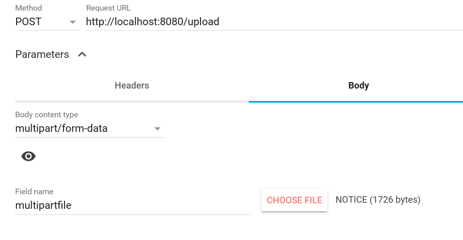

## Le controller

Cet endpoint `POST /upload` reçoit un fichier en `multipart/form-data` via le paramètre **`MultipartFile`** (nommé `multipartfile`) et retourne ici son contenu sous forme de texte :

```java
@PostMapping(value = "/upload", consumes = MediaType.MULTIPART_FORM_DATA_VALUE)
public String upload(@RequestParam MultipartFile multipartfile) throws IOException {
    return new String(multipartfile.getBytes());
}
```

:::tip[Afficher le bouton d'upload dans Swagger UI]
Préciser `consumes = MediaType.MULTIPART_FORM_DATA_VALUE` permet à Swagger UI (`springdoc-openapi`) de reconnaître un envoi de fichier et d'afficher directement un bouton d'upload dans l'interface interactive.
:::

## Requête côté client

Requête HTTP avec l'en-tête **`Content-Type: multipart/form-data`** :



Pour tester rapidement en ligne de commande avec `curl` (en créant un fichier à la volée, et en reprenant le nom du `@RequestParam` `multipartfile`) :

```bash
# 1. Créer un fichier contenant une phrase de test
echo "Bonjour depuis un fichier envoyé à l'API !" > mon-fichier.txt

# 2. Envoyer le fichier en multipart/form-data (--form définit automatiquement le Content-Type)
curl --form "multipartfile=@mon-fichier.txt" http://localhost:8080/upload
```

## Sécurisation des uploads : Pourquoi valider avant d'insérer ?

Chaîne de contrôle requise pour contrer 4 risques majeurs :

- **Déni de service (DoS / OOM) :**  
  Gros fichier chargé en mémoire (`getBytes`) ou Zip Bomb -> saturation de la JVM et crash du pod.
- **Path Traversal & écriture arbitraire :**  
  Nom forgé (`../../tmp/exec.sh`) -> écrasement de fichiers système et risque d'exécution de code (RCE).
- **Injection XML (XXE / SSRF) :**  
  Résolution d'entités externes via la DTD -> lecture de fichiers locaux (`/etc/passwd`, secrets) ou pivot réseau.
- **Injection de formule (CSV / Excel) :**  
  Cellules piégées stockées telles quelles (`=cmd|...`) -> exécution de commandes à l'ouverture du tableur en interne.

## Ordre chronologique des contrôles

Valider de l'extérieur vers l'intérieur (du moins coûteux au plus coûteux) :

1. **Rejet précoce :** Quotas HTTP et validation de présence (zéro CPU consommé).
2. **Contrôle du contenant :** Nom sécurisé (`UUID`) et signature binaire (*Magic Bytes*).
3. **Parsing en flux (Streaming) :** Désactivation DTD (XML) et assainissement des formules (CSV).
4. **Persistance maîtrisée :** Découpage en lots pour préserver la RAM et libérer le cache JPA.

## Quotas, Nom et Signature binaire

Bloquer les payloads malveillants avant même d'analyser les données métier.

```yml
# Bloquer en amont au niveau du serveur
spring.servlet.multipart.max-file-size: 10MB
spring.servlet.multipart.max-request-size: 10MB
```

```java
// Anti-Path Traversal (si écriture disque/S3) : nom technique aléatoire
String original = Optional.ofNullable(file.getOriginalFilename())
    .map(name -> Paths.get(name).getFileName().toString())
    .orElse("upload");
String safeName = UUID.randomUUID() + "-" + original;

// Anti-Spoofing : vérification des octets réels (Apache Tika)
String mime = new Tika().detect(file.getInputStream());
if (!List.of("text/csv", "text/plain").contains(mime)) {
    throw new SecurityException("Format illégitime : " + mime);
}
```

## Traitement en flux & Transaction atomique

La transaction garantit l'annulation totale (*Rollback*) en cas d'erreur

```java
@Transactional(rollbackFor = Exception.class)
public void process(MultipartFile file) throws IOException {
    try (BufferedReader reader = new BufferedReader(new InputStreamReader(file.getInputStream()))) {
        List<Client> batch = new ArrayList<>(500);
        reader.lines().forEach(line -> {
            String[] cols = line.split(";");
            String safeNom = sanitize(cols[0]); // Neutralise =, +, -, @
            int millesime = Integer.parseInt(cols[1].trim());
            batch.add(new Vin(safeNom, millesime));
            if (batch.size() >= 500) {
                repository.saveAll(batch);
                entityManager.flush(); // Envoie les requêtes SQL en attente
                entityManager.clear(); // VIDE le cache Hibernate (évite l'OOM)
                batch.clear();         // Vide la liste Java
            }
        });
        if (!batch.isEmpty()) { repository.saveAll(batch); }
    }
}
private String sanitize(String val) {
    return (val != null && val.matches("^[=+\\-@\\t\\r].*")) ? "'" + val : val;
}
```
