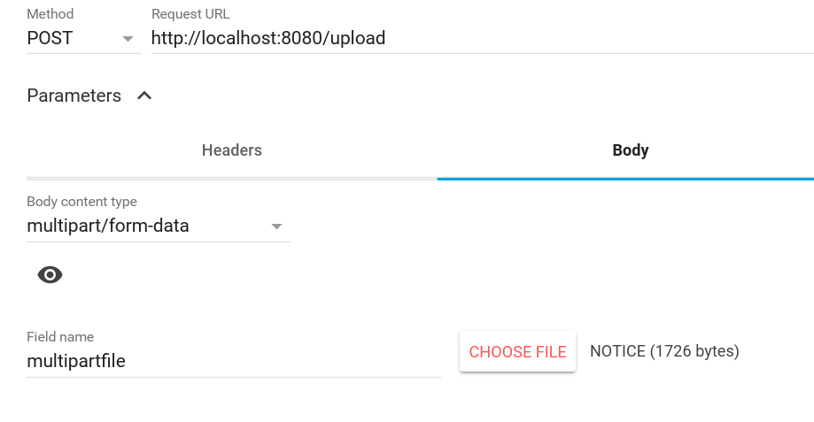

## Types de fichiers et traitements courants

Le mécanisme d'upload HTTP (`multipart/form-data` avec `MultipartFile`) est identique quel que soit le format envoyé : il permet de recevoir aussi bien des **fichiers texte / structurés** (`CSV`, `JSON`, `XML`…) que des **fichiers binaires** (photos, `PDF`, documents LibreOffice Writer/Calc, Word/Excel…).

Une fois le fichier reçu et validé côté API, le traitement dépend de sa nature :

- **Fichiers structurés (`CSV`, `JSON`, `XML`) :** le plus souvent parsés (en flux / *streaming* si le volume est important) afin d'extraire les données et de les enregistrer en base de données.
- **Fichiers binaires (photos, `PDF`, documents Writer/Calc…) :**
  - **Enregistrement tel quel en base de données (ex. PostgreSQL)** si le volume reste limité : cela permet de rester **dans la même transaction** que les données métier associées (cohérence garantie en cas de *rollback* et sauvegardes centralisées) tout en évitant d'avoir à gérer un second système de stockage (ce qui limite la complexité du SI).
  - **Stockage sur un serveur de fichiers ou un stockage objet (type S3)** dès que les fichiers sont volumineux ou nombreux : on ne conserve alors en base que les métadonnées et la référence vers le fichier, pour éviter d'alourdir la base de données.

## Les différents cas d'upload

En Spring MVC, la réception de fichiers s'appuie sur le type de contenu `multipart/form-data` (`consumes = MediaType.MULTIPART_FORM_DATA_VALUE`) et les annotations `@RequestParam` ou `@RequestPart` selon que la requête transporte un ou plusieurs fichiers, seuls ou accompagnés de données JSON.

:::tip[Afficher le bouton d'upload dans Swagger UI]
Préciser `consumes = MediaType.MULTIPART_FORM_DATA_VALUE` permet à Swagger UI (`springdoc-openapi`) de reconnaître un envoi de fichier et d'afficher directement un bouton d'upload dans l'interface interactive.
:::

### 1. Recevoir un fichier unique (`MultipartFile`)

Cet endpoint `POST /upload` reçoit un fichier en `multipart/form-data` via le paramètre **`MultipartFile`** (nommé `multipartfile`) et retourne ici son contenu sous forme de texte :

**Côté controller :**

```java
@PostMapping(value = "/upload", consumes = MediaType.MULTIPART_FORM_DATA_VALUE)
public String upload(@RequestParam MultipartFile multipartfile) throws IOException {
    return new String(multipartfile.getBytes());
}
```

**Requête côté client :**

- **Avec un client HTTP graphique** (Postman, Insomnia, Bruno…) en sélectionnant le type de corps **`multipart/form-data`** :



- **En ligne de commande avec `curl`** (en créant un fichier à la volée, et en reprenant le nom du `@RequestParam` `multipartfile`) :

```bash
# 1. Créer un fichier contenant une phrase de test
echo "Bonjour depuis un fichier envoyé à l'API !" > mon-fichier.txt

# 2. Envoyer le fichier en multipart/form-data (--form définit automatiquement le Content-Type)
curl --form "multipartfile=@mon-fichier.txt" http://localhost:8080/upload
```

### 2. Recevoir plusieurs fichiers (`List<MultipartFile>`)

Il suffit de remplacer `MultipartFile` par `List<MultipartFile>` (ou `MultipartFile[]`) côté controller, et de répéter `--form` côté `curl` :

**Côté controller :**

```java
@PostMapping(value = "/upload-multiple", consumes = MediaType.MULTIPART_FORM_DATA_VALUE)
public List<String> uploadMultiple(@RequestParam("files") List<MultipartFile> files) {
    return files.stream()
            .map(MultipartFile::getOriginalFilename)
            .toList();
}
```

**Requête côté client :**

```bash
# 1. Créer deux fichiers de test
echo "Contenu du fichier 1" > fichier1.txt
echo "Contenu du fichier 2" > fichier2.txt

# 2. Envoyer les deux fichiers en répétant --form
curl --form "files=@fichier1.txt" --form "files=@fichier2.txt" http://localhost:8080/upload-multiple
```

### 3. Recevoir un fichier accompagné d'un objet JSON (`@RequestPart`)

Pour envoyer à la fois un fichier et un DTO JSON existant (comme `CreateVinRequest`) dans la même requête, utilisez **`@RequestPart`** sur chaque partie :

**Côté controller :**

```java
@PostMapping(value = "/upload-vin", consumes = MediaType.MULTIPART_FORM_DATA_VALUE)
public String uploadAvecVin(
        @RequestPart("vin") @Valid CreateVinRequest vin,
        @RequestPart("file") MultipartFile file) {
    return vin.chateau() + " -> " + file.getOriginalFilename();
}
```

**Requête côté client :**

```bash
# 1. Créer les fichiers de test
echo "Fiche technique du Château Margaux" > fiche-vin.txt
echo '{"chateau":"Château Margaux","appellation":"Margaux","prix":500}' > vin.json

# 2. Envoyer l'objet JSON (<vin.json) + le fichier (@fiche-vin.txt)
curl \
  --form "vin=<vin.json;type=application/json" \
  --form "file=@fiche-vin.txt" \
  http://localhost:8080/upload-vin
```

:::tip[Penser au `;type=application/json` sur la partie JSON]
Avec `curl`, si vous omettez `;type=application/json` sur la partie `vin`, Spring ne sait pas qu'il s'agit de JSON et rejette la requête avec une erreur **`415 Unsupported Media Type`**.

La syntaxe `<vin.json` indique à `curl` de lire le contenu du fichier comme valeur texte du champ (contrairement à `@` qui l'envoie comme un fichier uploadé). Il est aussi possible d'écrire l'objet JSON directement en ligne :

```bash
--form 'vin={"chateau":"Château Margaux","appellation":"Margaux","prix":500};type=application/json'
```

Cette forme directe fonctionne sous Linux et macOS, mais peut provoquer des erreurs d'encodage sur les accents (comme `â`) sous Windows, y compris dans Git Bash lorsque `curl.exe` de Windows est invoqué.
:::

## Sécurisation et traitement des uploads

### Pourquoi valider avant d'insérer ?

Un fichier envoyé par un client n'est jamais fiable par défaut : son nom, sa taille, son extension et son contenu peuvent être falsifiés ou malveillants. Si l'application le charge en mémoire, l'écrit sur disque ou insère ses données en base **avant** de le contrôler, l'impact a déjà lieu :

- **Saturer la mémoire et faire tomber le serveur :**  
  Un fichier volumineux chargé d'un bloc avec `file.getBytes()`, ou une archive compressée piégée qui se décompresse en gigaoctets de données, peut provoquer une `OutOfMemoryError` et arrêter l'application.
- **Écrire au mauvais endroit sur le serveur :**  
  Un nom de fichier forgé comme `../../tmp/script.sh` permet de sortir du dossier prévu et d'écraser des fichiers existants (*Path Traversal*).
- **Exposer des fichiers internes via un XML piégé :**  
  Un parseur XML mal configuré peut résoudre des références externes contenues dans le fichier pour lire des fichiers sensibles du serveur (`/etc/passwd`, secrets) ou appeler des services internes.
- **Piéger les utilisateurs internes avec un CSV ou un fichier Excel :**  
  Des cellules commençant par `=`, `+`, `-` ou `@` (par exemple `=cmd|...`) stockées telles quelles seront interprétées comme des formules et exécutées lorsque le fichier exporté sera ouvert dans un tableur.

### Ordre chronologique des contrôles

Valider de l'extérieur vers l'intérieur (du moins coûteux au plus coûteux) :

1. **Rejet précoce :** Quotas HTTP et validation de présence (zéro CPU consommé).
2. **Contrôle du contenant :** Nom sécurisé (`UUID`) et vérification du contenu réel du fichier (signature binaire).
3. **Lecture en flux (*streaming*) :** Désactivation des entités externes (XML) et neutralisation des formules (CSV).
4. **Persistance maîtrisée :** Découpage en lots pour préserver la RAM et libérer le cache JPA.

### Quotas, nom et signature binaire

Bloquer les payloads malveillants avant même d'analyser les données métier.

```yml
# Bloquer en amont au niveau du serveur
# Taille max par fichier
spring.servlet.multipart.max-file-size: 10MB
# Taille max totale de la requête (utile avec plusieurs fichiers)
spring.servlet.multipart.max-request-size: 10MB
```

```java
// Anti-Path Traversal (si écriture disque/S3) : nom technique aléatoire
String original = Optional.ofNullable(file.getOriginalFilename())
    .map(name -> Paths.get(name).getFileName().toString())
    .orElse("upload");
String safeName = UUID.randomUUID() + "-" + original;

// Anti-Spoofing : vérification des octets réels (Apache Tika)
String mime = new Tika().detect(file.getInputStream());
if (!List.of("text/csv", "text/plain").contains(mime)) {
    throw new SecurityException("Format illégitime : " + mime);
}
```

### Traitement en flux & Transaction atomique

La transaction garantit l'annulation totale (*Rollback*) en cas d'erreur

```java
@Transactional(rollbackFor = Exception.class)
public void process(MultipartFile file) throws IOException {
    try (BufferedReader reader = new BufferedReader(new InputStreamReader(file.getInputStream()))) {
        List<Vin> batch = new ArrayList<>(500);
        reader.lines().forEach(line -> {
            String[] cols = line.split(";");
            String safeNom = sanitize(cols[0]); // Neutralise =, +, -, @
            int millesime = Integer.parseInt(cols[1].trim());
            batch.add(new Vin(safeNom, millesime));
            if (batch.size() >= 500) {
                repository.saveAll(batch);
                entityManager.flush(); // Envoie les requêtes SQL en attente
                entityManager.clear(); // VIDE le cache Hibernate (évite l'OOM)
                batch.clear();         // Vide la liste Java
            }
        });
        if (!batch.isEmpty()) { repository.saveAll(batch); }
    }
}
private String sanitize(String val) {
    return (val != null && val.matches("^[=+\\-@\\t\\r].*")) ? "'" + val : val;
}
```
