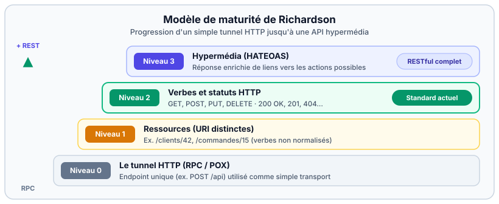
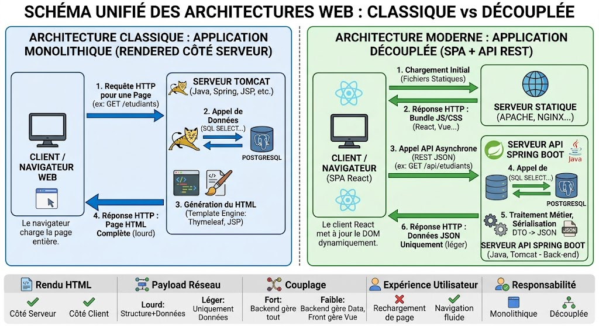

## L'architecture REST

Une architecture **REST** (*REpresentational State Transfer*) repose notamment sur les principes suivants :

- **Séparation client-serveur :** le client gère l'interface utilisateur et le serveur expose les données et la logique métier.
- **Sans état (*stateless*) :** contrairement à une application web classique avec session serveur (`HttpSession` via cookie), l'API respecte strictement la nature sans état d'HTTP et ne conserve aucune session client en mémoire entre deux requêtes. Comment s'en passer ?
  - **Pour l'identité et les droits :** chaque requête est auto-porteuse et fournit elle-même un jeton (ex. JWT dans l'en-tête `Authorization: Bearer ...`), que le serveur valide sans rien garder en mémoire.
  - **Pour les données métier (panier, filtres, brouillon…) :** l'état reste soit **côté client** (interface front-end, paramètres d'URL), soit **persisté en base de données** en tant que ressource à part entière (ex. `POST /paniers`). N'importe quelle instance du serveur peut ainsi répondre à la requête suivante, ce qui facilite la mise à l'échelle.
- **Orientation ressources :** les données sont modélisées en ressources identifiées par des URI et manipulées via les méthodes standards du protocole HTTP.

### Le modèle de maturité de Richardson

Pour situer le degré de conformité d'une API aux principes REST, Leonard Richardson a défini **quatre niveaux de maturité** (seul le dernier correspond strictement à une API dite *RESTful*) :

- **Niveau 0 — Le tunnel HTTP :** HTTP sert uniquement de protocole de transport. L'API expose un endpoint unique (ex. `/api`) et généralement une seule méthode (`POST`) pour invoquer des opérations distantes (style SOAP / RPC).
- **Niveau 1 — Les ressources (URI distinctes) :** l'application est découpée en ressources adressables chacune par sa propre URI (ex. `/clients/42`, `/commandes/15`), mais les verbes et statuts HTTP ne sont pas encore normalisés (ex. `POST /clients/42/supprimer`).
- **Niveau 2 — Les verbes et statuts HTTP *(Standard actuel)* :** utilisation standard de la sémantique HTTP :
  - verbes adaptés aux opérations (`GET`, `POST`, `PUT` / `PATCH`, `DELETE`) ;
  - codes retour explicites (`200 OK`, `201 Created`, `204 No Content`, `400 Bad Request`, `404 Not Found`…).
- **Niveau 3 — Les contrôles hypermédias (HATEOAS) :** *Hypermedia As The Engine Of Application State*. La réponse contient les données **et** des liens navigables indiquant les actions possibles depuis l'état courant.

:::tip[Objectif de la formation]
En pratique, la grande majorité des API REST modernes visent le **Niveau 2** (ressources, verbes HTTP et codes de statut adaptés).
:::

## Architecture traditionnelle vs architecture découplée

Une architecture découplée sépare le **front-end** (interface utilisateur servie en fichiers statiques) du **back-end** (API REST exposant uniquement les données) :

- **Expérience utilisateur plus fluide et trafic réduit :** après le chargement initial de l'interface, seuls des payloads JSON légers circulent et seule la zone concernée de la page est mise à jour, sans rechargement complet du HTML.
- **Séparation des responsabilités et réutilisabilité :** le back-end et le front-end évoluent et se déploient indépendamment, et une même API peut alimenter une application web, une application mobile ou d'autres services.
- **Partage d'informations en temps réel entre applications** (plutôt que par échanges de fichiers) :
  - les données sont consultables à jour à la demande, sans attendre un transfert ni un import de fichier ;
  - plus besoin de développer et maintenir des mécanismes de lecture et d'intégration de fichiers ;
  - pas de redondance des données : économie de stockage et aucun écart de synchronisation entre sources.

:::note[Pour la suite]
La page suivante illustre concrètement le passage du modèle traditionnel (Servlet / JSP) vers une API JSON avec un [exemple Java EE](/formation-api-rest/fondamentaux/exemple-java-ee/), avant d'aborder Spring Boot.
:::
