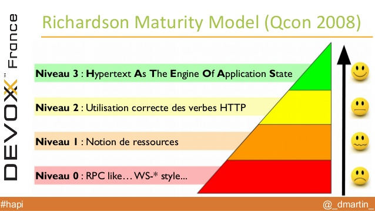
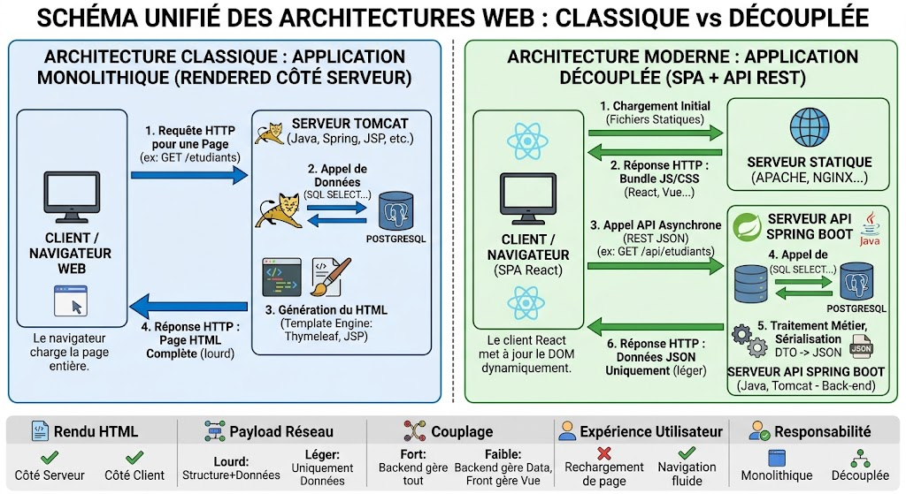

import { Steps } from '@astrojs/starlight/components';

## L'architecture REST

Principes clés d'une API REST :

- Elle doit être sans état (**stateless**) : aucune donnée n'est conservée par le serveur entre 2 requêtes, ce qui facilite le passage à l'échelle sur plusieurs instances de serveurs.
- **Modèle de maturité de Richardson** : quatre niveaux d'évaluation d'une API (le dernier niveau correspond à une API dite *RESTful*).

<Steps>

1. **Niveau 0 — Le tunnel HTTP**

   HTTP sert uniquement de protocole de transport. L'API utilise un endpoint unique (ex. `/api`) et souvent une seule méthode (`POST`) pour exécuter des fonctions distantes (style SOAP).

2. **Niveau 1 — Les ressources (URI distinctes)**

   Découpage de l'application en entités individuelles adressables par une URI propre (ex. `/clients/42`, `/commandes/15`). En revanche, les verbes et codes HTTP ne sont pas encore normalisés (ex. `POST /clients/42/supprimer`).

3. **Niveau 2 — Les verbes et statuts HTTP *(Standard actuel)***

   Utilisation standard de la sémantique HTTP :
   - Verbes adaptés aux opérations : `GET` (lecture), `POST` (création), `PUT` / `PATCH` (mise à jour), `DELETE` (suppression)
   - Codes retour explicites (`200 OK`, `201 Created`, `204 No Content`, `400 Bad Request`, `404 Not Found`)

4. **Niveau 3 — Les contrôles hypermédias (HATEOAS)**

   *Hypermedia As The Engine Of Application State*. La réponse contient les données brutes **et** des liens navigables indiquant les actions possibles depuis l'état courant.

</Steps>

:::tip[Objectif de la formation]
En pratique, la grande majorité des API REST modernes visent le **Niveau 2** (ressources, verbes HTTP et codes de statut adaptés).
:::

## Architecture traditionnelle vs architecture découplée

Intérêts de l'architecture découplée : rapidité, partage d'informations instantané entre applications.

- **Application plus fluide** : rafraîchissement d'une partie de la page au lieu du chargement complet.
- **Partage d'informations** par appels d'API plutôt que par échanges de fichiers :
  - pas d'attente de recevoir un fichier pour avoir une information à jour ;
  - pas besoin de gérer la lecture de fichiers et l'import de données ;
  - pas de redondance de données : économie de stockage et pas d'écart entre les différentes sources.
