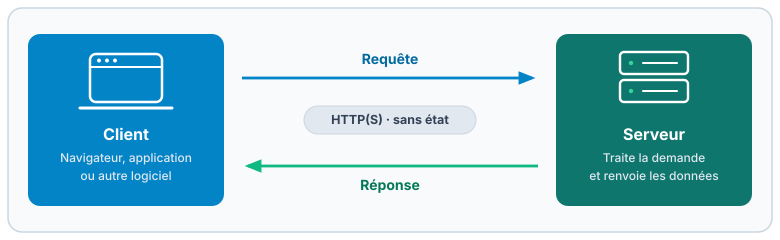

## Définition

HTTP (Hypertext Transfer Protocol) est un protocole de communication client-serveur développé pour le World Wide Web. Il est utilisé pour échanger toute sorte de données entre client HTTP et serveur HTTP.

HTTP est un protocole **sans état (*stateless*)** : chaque requête est traitée indépendamment des précédentes, sans que le protocole ne conserve de contexte entre deux appels *(les mécanismes de session web via cookies ont justement été ajoutés par-dessus HTTP pour permettre au serveur de conserver des informations d'une requête à l'autre, par exemple l'utilisateur connecté, un panier d'achat ou la progression d'un formulaire multi-étapes)*.



## Les méthodes de requêtes (ou verbes) HTTP

HTTP définit un [ensemble de méthodes](https://developer.mozilla.org/fr/docs/Web/HTTP/M%C3%A9thode) de requête qui indiquent l'action que l'on souhaite réaliser sur la ressource indiquée :

| Méthode | Rôle | Corps de requête |
| --- | --- | --- |
| **GET** | Récupère une représentation de la ressource (lecture seule) | Non |
| **HEAD** | Identique à `GET`, mais sans le corps de la réponse (en-têtes uniquement) | Non |
| **POST** | Envoie une entité vers la ressource (création ou effet de bord sur le serveur) | Oui |
| **PUT** | Remplace toutes les représentations actuelles de la ressource visée | Oui |
| **PATCH** | Applique des modifications partielles à une ressource | Oui |
| **DELETE** | Supprime la ressource indiquée | Non |
| **OPTIONS** | Décrit les options de communication avec la ressource visée (utilisé pour CORS) | Non |

## La requête HTTP

```http
Méthode URL Version-du-protocole
En-têtes de requête

Corps de requête
```

- **Méthode** : précise le type de requête (`HEAD`, `GET`, `POST`…)
- **URL** : adresse de la ressource sur le serveur
- **Version du protocole HTTP** (ex. `HTTP/1.1`, `HTTP/2`)
- **En-têtes** sous la forme `clé: valeur` ([liste des headers sur MDN](https://developer.mozilla.org/fr/docs/Web/HTTP/Headers)) :
  - **Host** spécifie le nom de domaine du site
  - **Cookie** permet d'envoyer au serveur les cookies enregistrés sur le poste du client à la demande du serveur
  - **Content-Type** spécifie le type MIME du corps de la requête
  - **Content-Length** spécifie la longueur du corps de la requête
  - **Accept** spécifie le type de contenu accepté par le client (par exemple `text/html` ou `application/json`)
- **Corps de la requête** : optionnel, peut par exemple contenir les données d'un formulaire HTML passé en `POST` sous la forme `variable1=valeur1&variable2=valeur2` ou un document JSON

### Exemple de requête HTTP

```http
GET / HTTP/1.1
Host: developer.mozilla.org
Accept-Language: fr
```

```http
POST / HTTP/1.1
Host: foo.com
Content-Type: application/x-www-form-urlencoded
Content-Length: 13

say=Hi&to=Mom
```

Dans une requête `POST`, il faut spécifier le type de données. Pour un formulaire HTML, il y a 2 valeurs possibles :

- `application/x-www-form-urlencoded` (valeur par défaut)
- `multipart/form-data` (utilisé pour l'envoi de fichiers)

Il faut également spécifier la longueur du corps (`Content-Length`).

### Structure d'une URL d'API HTTP

```http
https://mon-api/{variable-de-chemin}?parametre-de-requete-1=valeur&parametre-de-requete-2=valeur
```

- **Variables de chemin** : souvent utilisées pour les identifiants obligatoires.
- **Paramètres de requête** :
  - `?` à la fin de l'URL suivi de `clé=valeur`, puis `&` pour séparer les autres paramètres ;
  - souvent utilisés pour les options non obligatoires, notamment le filtrage ou la pagination.

:::tip[Exemple concret : API Sirene (Insee)]
```http
# Sans paramètre : retourne l'historique complet du SIREN
GET https://api.insee.fr/entreprises/sirene/V3/siren/{siren}

# Avec paramètre de requête : filtre uniquement la période à cette date
GET https://api.insee.fr/entreprises/sirene/V3/siren/{siren}?date={date}
```
:::

## La réponse HTTP

```http
Version Code-réponse Texte-réponse
En-têtes de réponse

Corps de réponse
```

- **Version HTTP** du serveur
- **Code-réponse** : le code retourné, par exemple `200`, `404`, `500`
- **Texte-réponse** : le libellé associé, par exemple `OK`, `Not Found`, `Internal Server Error`
- **En-têtes** :
  - **Date** : date de génération de la réponse
  - **Server** : spécifie le serveur HTTP utilisé
  - **Set-Cookie** : demande au navigateur d'enregistrer un cookie
- **Corps de la réponse** : contient les données renvoyées (HTML, JSON, fichier…)

### Exemple de réponse HTTP

```http
HTTP/1.1 200 OK
Date: Sat, 09 Oct 2010 14:28:02 GMT
Server: Apache
Last-Modified: Tue, 01 Dec 2009 20:18:22 GMT
ETag: "51142bc1-7449-479b075b2891b"
Accept-Ranges: bytes
Content-Length: 29769
Content-Type: text/html

<!DOCTYPE html>... (suivi des 29769 octets de la page web demandée)
```

### Les codes de statut de réponse HTTP

Voir la [documentation Mozilla des statuts HTTP](https://developer.mozilla.org/fr/docs/Web/HTTP/Status) :

| Famille | Signification | Exemples courants |
| --- | --- | --- |
| **1xx** | Information | `100 Continue`, `101 Switching Protocols` |
| **2xx** | Succès | `200 OK`, `201 Created`, `204 No Content` |
| **3xx** | Redirection | `301 Moved Permanently`, `304 Not Modified` |
| **4xx** | Erreur du client | `400 Bad Request`, `401 Unauthorized`, `403 Forbidden`, `404 Not Found` |
| **5xx** | Erreur du serveur | `500 Internal Server Error`, `502 Bad Gateway`, `503 Service Unavailable` |

## L'en-tête `Content-Type` (et `Accept`)

L'en-tête HTTP **`Content-Type`** indique le format (**type MIME** ou *Media Type*) du **corps** transporté dans le message HTTP. Il s'utilise dans les deux sens :

- **Dans une requête** (`POST`, `PUT`, `PATCH`) : indique au **serveur** comment interpréter les données envoyées par le client (s'il est absent ou non géré, l'API répond **`415 Unsupported Media Type`**).
- **Dans une réponse** : indique au **client** le format des données renvoyées par le serveur.

> **Ne pas confondre `Content-Type` et `Accept` :**
> - `Content-Type` décrit **ce qui est envoyé** dans le corps du message courant (requête ou réponse).
> - `Accept` est envoyé par le client dans la **requête** pour indiquer **le format qu'il souhaite recevoir** en réponse (négociation de contenu ; si le serveur ne peut pas le produire, il répond **`406 Not Acceptable`**).

### Principaux types MIME

Un type MIME s'écrit `type/sous-type`, éventuellement suivi de paramètres (`; charset=UTF-8`, `; boundary=...` pour `multipart/form-data`) :

| Type MIME | Usage courant |
| :--- | :--- |
| `application/json` | Format standard des API REST (UTF-8 natif selon la RFC 8259) |
| `application/xml` | Échanges XML (services historiques, flux structurés) |
| `application/x-www-form-urlencoded` | Formulaire HTML classique (`cle1=val1&cle2=val2`) |
| `multipart/form-data` | Envoi de fichiers accompagnés de champs de formulaire |
| `text/plain`, `text/html`, `text/csv` | Contenu textuel (préciser `; charset=UTF-8` pour préserver les accents) |
| `application/pdf`, `application/octet-stream` | Fichiers binaires (document PDF, téléchargement générique) |

*(Voir aussi la [liste des types MIME sur MDN](https://developer.mozilla.org/fr/docs/Web/HTTP/Basics_of_HTTP/MIME_types/Complete_list_of_MIME_types).)*

:::tip[Bonne pratique : UTF-8 partout]
Utilisez systématiquement **UTF-8** pour vos fichiers sources et vos échanges HTTP. En **`application/json`**, UTF-8 est implicite (il est inutile d'ajouter `; charset=UTF-8`). En revanche, pour les formats **`text/*`** (`text/html`, `text/csv`, `text/plain`), précisez explicitement `; charset=UTF-8` afin d'éviter les problèmes d'accents (historiquement *ISO-8859-1* / *Latin-1*).
:::

Côté serveur, Spring Boot renseigne automatiquement `application/json` sur un `@RestController` (et permet de le configurer finement avec `consumes` et `produces`, vus dans [Annotations Spring Web & formats](/formation-api-rest/api-rest/annotations/)). En Java EE (Servlet), on le définit directement sur `HttpServletResponse` :

```java
response.setContentType("text/html; charset=UTF-8");
```

*(Équivalent en deux appels : `response.setContentType("text/html");` suivi de `response.setCharacterEncoding("UTF-8");`.)*

## Tester des requêtes HTTP en pratique

Pour appeler une URL ou tester une API sans écrire de code applicatif :

- 🌐 **Navigateur web :** pratique directement depuis la barre d'adresse, mais limité aux requêtes `GET`.
- 🧪 **Client REST dédié (`Insomnia`, `Postman`) :** indispensable pour envoyer des requêtes `POST`, `PUT`, `PATCH` ou `DELETE`, configurer des en-têtes (`Content-Type`, `Authorization`…) et inspecter le statut et le corps de réponse.
- 📘 **Documentation interactive Swagger :** lorsque l'API en expose une, elle permet d'exécuter des requêtes directement dans l'interface (par exemple [FakeRestAPI](http://fakerestapi.azurewebsites.net/)).
- 💻 **Ligne de commande (`curl` + `jq`) :** idéal pour reproduire ou scripter un appel depuis un terminal.

  Afficher les en-têtes HTTP de la réponse en plus du corps (`--include`) :

  ```bash
  curl --include https://jsonplaceholder.typicode.com/posts/1
  ```

  Masquer la barre de progression (`--silent`) et formater le JSON dans `jq` :

  ```bash
  curl --silent https://jsonplaceholder.typicode.com/posts/1 | jq .
  ```

  *(**`jq`** est un utilitaire en ligne de commande dédié au JSON : il permet de **l'indenter et le colorer** pour le rendre lisible (`jq .`), ou d'**extraire et filtrer** des champs dans un script, par exemple `| jq '.title'`.)*

- 📊 **Autres outils :** `LibreOffice`, `R`, `Python`, etc. — tout logiciel capable d'émettre une requête HTTP peut interroger une API.

*(Les appels programmatiques depuis une application Java avec `RestClient` ou `HttpClient` et en JavaScript sont détaillés dans la page [Consommation d'une API REST](/formation-api-rest/api-rest/consommation-api-rest/).)*
