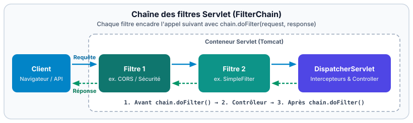
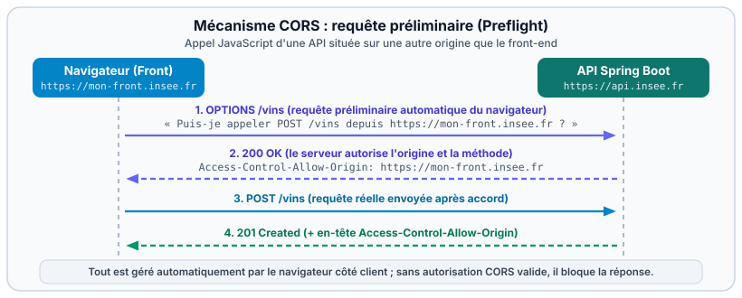

## La notion de filtre Servlet

Un **filtre** (`jakarta.servlet.Filter`) est un composant Java placé en amont du contrôleur qui intercepte les requêtes et les réponses HTTP. Il permet d'exécuter un traitement systématique (logs, en-têtes de sécurité, CORS, contrôle d'accès…) avant et après le traitement métier.



### Exemple de filtre global (`@Component`)

En annotant la classe avec `@Component`, le filtre s'applique automatiquement à **toutes** les URLs de l'application :

```java title="SimpleFilter.java"
import jakarta.servlet.Filter;
import jakarta.servlet.FilterChain;
import jakarta.servlet.ServletException;
import jakarta.servlet.ServletRequest;
import jakarta.servlet.ServletResponse;
import jakarta.servlet.http.HttpServletRequest;
import lombok.extern.slf4j.Slf4j;
import org.springframework.core.annotation.Order;
import org.springframework.stereotype.Component;

@Slf4j
@Component
@Order(2) // Ordre d'exécution dans la chaîne des filtres
public class SimpleFilter implements Filter {

    @Override
    public void doFilter(ServletRequest request, ServletResponse response, FilterChain chain)
            throws IOException, ServletException {

        HttpServletRequest httpRequest = (HttpServletRequest) request;
        log.info("Début de la requête {}", httpRequest.getRequestURI());

        chain.doFilter(request, response); // Passe la main au filtre suivant / contrôleur

        log.info("Fin de la requête {}", httpRequest.getRequestURI());
    }
}
```

### Restreindre un filtre à certaines URLs (`FilterRegistrationBean`)

Pour n'appliquer un filtre qu'à un motif d'URL précis (par exemple `/vin/*`), **retirez `@Component`** de la classe du filtre et déclarez un `FilterRegistrationBean` dans une classe `@Configuration` :

```java title="PartialFilter.java"
@Slf4j
public class PartialFilter implements Filter {

    @Override
    public void doFilter(ServletRequest request, ServletResponse response, FilterChain chain)
            throws IOException, ServletException {

        HttpServletRequest req = (HttpServletRequest) request;
        HttpServletResponse res = (HttpServletResponse) response;

        log.info("Requête sur /vin : {} {}", req.getMethod(), req.getRequestURI());
        chain.doFilter(request, response);
        log.info("Réponse /vin (Content-Type) : {}", res.getContentType());
    }
}
```

```java title="FilterConfig.java"
@Configuration
public class FilterConfig {

    @Bean
    public FilterRegistrationBean<PartialFilter> loggingFilter() {
        FilterRegistrationBean<PartialFilter> registrationBean = new FilterRegistrationBean<>();
        registrationBean.setFilter(new PartialFilter());
        registrationBean.addUrlPatterns("/vin/*");
        registrationBean.setOrder(3);
        return registrationBean;
    }
}
```

## Compresser les réponses HTTP

Lorsque les réponses JSON sont volumineuses, le serveur peut les compresser à la volée si le client annonce qu'il supporte la compression via l'en-tête **`Accept-Encoding: gzip`** (le serveur renvoie alors **`Content-Encoding: gzip`** et le navigateur décompresse automatiquement).

:::note[En pratique avec Spring Boot]
Avec le serveur embarqué de Spring Boot (Tomcat/Jetty/Undertow), il suffit d'activer `server.compression.enabled=true` dans `application.properties` (voir [Packaging et configuration par environnement](/formation-api-rest/deploiement/packaging-environnements/#activer-la-compression-des-réponses-http)).

Dans d'anciennes architectures `.war` sur serveur externe, on utilisait parfois une bibliothèque tierce comme [Ziplet](https://github.com/ziplet/ziplet) enregistrée via `FilterRegistrationBean` *(attention : Ziplet 2.x repose sur l'ancien namespace `javax.servlet`)*.
:::

<details>
<summary>Exemple historique avec Ziplet (hérité javax.servlet)</summary>

```xml title="pom.xml"
<dependency>
    <groupId>com.github.ziplet</groupId>
    <artifactId>ziplet</artifactId>
    <version>2.4.1</version>
</dependency>
```

```java title="ZipletConfig.java"
@Configuration
public class ZipletConfig {

    @Bean
    public FilterRegistrationBean<CompressingFilter> compressingFilter() {
        FilterRegistrationBean<CompressingFilter> registrationBean = new FilterRegistrationBean<>();
        registrationBean.setFilter(new CompressingFilter());
        registrationBean.setOrder(1);
        return registrationBean;
    }
}
```

</details>

## CORS (*Cross-Origin Resource Sharing*)

### Principe et requête préliminaire (*Preflight*)

Par sécurité (*Same-Origin Policy*), un navigateur bloque les appels JavaScript émis vers une **origine différente** (protocole, domaine ou port distinct) de celle qui a servi la page web.

Pour autoriser ces appels multi-origines, le serveur doit renvoyer des en-têtes **CORS** (en particulier `Access-Control-Allow-Origin`). Pour les requêtes non simples (avec en-tête `Authorization`, `Content-Type: application/json`, méthode `PUT`/`DELETE`…), le navigateur gère tout **automatiquement côté client** : il envoie d'abord une requête préliminaire **`OPTIONS`** (*preflight*) pour vérifier les droits, puis envoie la vraie requête si le serveur l'y autorise :



### Configuration côté serveur avec Spring

Il suffit de déclarer les origines front-end autorisées dans `application.properties`, puis d'exposer un bean `CorsConfigurationSource` (automatiquement pris en compte par `http.cors(Customizer.withDefaults())` dans `SecurityFilterChain`) :

```properties title="application.properties"
# URLs front-end autorisées à appeler l'API depuis un navigateur
fr.insee.cors.authorized.urls=http://localhost:5173,http://localhost:3000
```

```java title="CorsConfig.java"
@Slf4j
@Configuration
public class CorsConfig {

    @Value("${fr.insee.cors.authorized.urls}")
    private String[] urls;

    @Bean
    public CorsConfigurationSource corsConfigurationSource() {
        log.info("URLs autorisées pour les appels CORS : {}", List.of(urls));

        CorsConfiguration configuration = new CorsConfiguration();
        configuration.setAllowedOriginPatterns(List.of(urls)); // Origines autorisées
        configuration.setAllowedMethods(List.of("*"));         // Méthodes HTTP autorisées
        configuration.setAllowedHeaders(List.of("*"));         // En-têtes autorisés (ex. Authorization)
        configuration.setMaxAge(3600L);                        // Durée de cache du preflight (1 h)

        UrlBasedCorsConfigurationSource source = new UrlBasedCorsConfigurationSource();
        source.registerCorsConfiguration("/**", configuration);
        return source;
    }
}
```

## Les intercepteurs Spring (`HandlerInterceptor`)

Alors qu'un **filtre Servlet** intervient au niveau Tomcat (avant même Spring Security et le routage Spring MVC), un **intercepteur Spring** se situe à l'intérieur du `DispatcherServlet`, juste autour de l'appel aux méthodes `@RestController` (ce qui donne accès au `HandlerMethod` ciblé, à ses annotations, etc.).

1. Implémentez l'interface **`HandlerInterceptor`** (`@Component`) en redéfinissant tout ou partie des 3 méthodes :
   - **`preHandle(...)`** : exécutée **avant** le contrôleur ; retourne `true` pour poursuivre l'appel, ou `false` pour l'interrompre.
   - **`postHandle(...)`** : exécutée **après** le contrôleur (avant le rendu éventuel d'une vue).
   - **`afterCompletion(...)`** : exécutée en toute fin de traitement de la requête (y compris en cas d'exception, utile pour nettoyer un `ThreadLocal` ou mesurer la durée totale).
2. Enregistrez l'intercepteur auprès de Spring MVC en implémentant **`WebMvcConfigurer`** (`addInterceptors(InterceptorRegistry registry)`).
