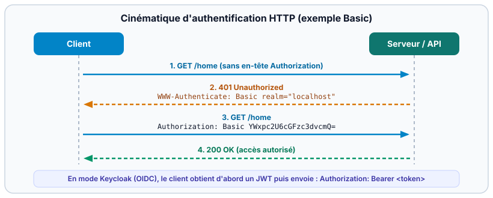

import { Steps, Tabs, TabItem } from '@astrojs/starlight/components';

## L'authentification HTTP

Le protocole HTTP fournit le mécanisme standard de contrôle d'accès via l'en-tête **`Authorization`** :

- **Basic (`username:password`) :** identifiants encodés en Base64 dans `Authorization: Basic ...`.
- **Bearer (jeton) :** jeton d'accès transmis dans `Authorization: Bearer <token>`.



### Premier essai avec `spring-boot-starter-security`

En ajoutant simplement la dépendance Spring Security dans `pom.xml`, tous les endpoints sont immédiatement protégés par une authentification Basic par défaut (utilisateur `user` avec un mot de passe généré dans la console au démarrage) :

```xml title="pom.xml"
<dependency>
    <groupId>org.springframework.boot</groupId>
    <artifactId>spring-boot-starter-security</artifactId>
</dependency>
```

## Configuration principale : Keycloak (OAuth2 Resource Server)

**Keycloak** est une solution open source permettant d'externaliser l'authentification via **OpenID Connect** (OIDC). Le client obtient un jeton JWT auprès de Keycloak, puis l'envoie dans l'en-tête HTTP `Authorization` :

```http
Authorization: Bearer <token>
```

Pour récupérer un jeton de test manuellement : [outil de récupération de jeton Keycloak](https://outils-transverses.gitlab-pages.insee.fr/authentification/recuperation-token/).

<Steps>

1. **Ajouter la dépendance OAuth2 Resource Server**

   ```xml title="pom.xml"
   <dependency>
       <groupId>org.springframework.boot</groupId>
       <artifactId>spring-boot-starter-oauth2-resource-server</artifactId>
   </dependency>
   ```

2. **Configurer Keycloak et la lecture du JWT dans `application.properties`**

   ```properties title="application.properties"
   keycloak.auth-server-url=https://auth.insee.test/auth
   keycloak.realm=agents-insee-interne

   spring.security.oauth2.resourceserver.jwt.jwk-set-uri=${keycloak.auth-server-url}/realms/${keycloak.realm}/protocol/openid-connect/certs
   spring.security.oauth2.resourceserver.jwt.authority-prefix=ROLE_
   spring.security.oauth2.resourceserver.jwt.principal-claim-name=preferred_username
   spring.security.oauth2.resourceserver.jwt.authorities-claim-name=groups

   # Active PKCE dans Swagger UI (voir la configuration Swagger OAuth2)
   springdoc.swagger-ui.oauth.use-pkce-with-authorization-code-grant=true
   # Mode de sécurité actif (si vous utilisez @ConditionalOnProperty ci-dessous)
   formationapirest.security=keycloak
   ```

3. **Créer `SecurityConfigurationKeycloakImpl` dans le package `config`**

   ```java title="SecurityConfigurationKeycloakImpl.java"
   @ConditionalOnProperty(name = "formationapirest.security", havingValue = "keycloak")
   @Configuration
   @EnableMethodSecurity(prePostEnabled = true, securedEnabled = true, jsr250Enabled = true)
   public class SecurityConfigurationKeycloakImpl {

       @Value("${spring.h2.console.enabled:false}")
       private boolean h2Enable;

       @Bean
       public SecurityFilterChain filterChain(HttpSecurity http) throws Exception {
           // Le filtre CORS doit passer en premier pour autoriser les requêtes cross-origin
           http.cors(Customizer.withDefaults());
           // Désactivation du CSRF et des sessions serveur (API REST stateless sans cookies)
           http.csrf(AbstractHttpConfigurer::disable);
           http.sessionManagement(session -> session
               .sessionAuthenticationStrategy(new NullAuthenticatedSessionStrategy())
               .sessionCreationPolicy(SessionCreationPolicy.STATELESS));
           // Authentification JWT : Bearer classique ou DPoP (jeton lié à la clé du client)
           http.oauth2ResourceServer(oauth2 -> oauth2
               .jwt(Customizer.withDefaults())
               .dPoP(Customizer.withDefaults()));
           // Règles d'accès aux routes
           http.authorizeHttpRequests(this::authorizedUrls);
           // Autorise l'affichage en frame pour la console H2 uniquement en local (risque de clickjacking)
           if (h2Enable) {
               http.headers(headers -> headers.frameOptions(FrameOptionsConfig::sameOrigin));
           }
           return http.build();
       }

       private void authorizedUrls(
           AuthorizeHttpRequestsConfigurer<HttpSecurity>.AuthorizationManagerRequestMatcherRegistry authorize
       ) {
           authorize
               .requestMatchers(HttpMethod.GET, "/", "/swagger-ui.html", "/swagger-ui/**", "/v3/api-docs/**").permitAll()
               .requestMatchers(HttpMethod.GET, "/vin", "/vin/**").permitAll()
               .requestMatchers("/mon-nom").authenticated()
               .requestMatchers("/environnement").hasRole("ADMIN_XXX");

           // Console H2 autorisée uniquement en local si activée
           if (h2Enable) {
               authorize.requestMatchers("/h2-console/**").permitAll();
           }

           // Refus explicite de toutes les autres requêtes non déclarées
           authorize.anyRequest().denyAll();
       }
   }
   ```

</Steps>

:::note[À propos de `@ConditionalOnProperty` et de Swagger]
- Si votre projet n'utilise **que** Keycloak, vous pouvez retirer l'annotation `@ConditionalOnProperty(...)` de `SecurityConfigurationKeycloakImpl` (sinon, pensez bien à définir `formationapirest.security=keycloak` dans `application.properties`, faute de quoi la classe ne sera pas chargée).
- Pour activer le bouton **Authorize** dans Swagger UI avec Keycloak, complétez `OpenApiConfiguration` comme indiqué dans [Documenter son API avec Swagger](/formation-api-rest/api-rest/swagger/#intégrer-lauthentification-keycloak-oauth2).
:::

## Exploiter les rôles et l'identité dans un contrôleur

### Protéger un endpoint par annotation

Grâce à `jsr250Enabled = true` sur `@EnableMethodSecurity`, vous pouvez restreindre l'accès directement au niveau d'une méthode avec `@RolesAllowed` (ou `@PreAuthorize` avec `prePostEnabled = true`) :

```java
@RolesAllowed("ADMIN_TOUCAN")
@GetMapping("/hello-secured")
public String helloWorldSecured() {
    return "Hello World sécurisé !";
}
```

### Adapter le comportement selon le rôle (`isUserInRole`)

Contrairement à `@RolesAllowed` qui bloque tout l'endpoint en `403 Forbidden`, `HttpServletRequest.isUserInRole(role)` retourne `true` ou `false` dans le code Java. Cela permet de garder une même route accessible tout en adaptant son comportement au profil de l'appelant :

- **Enrichir la réponse selon le profil :** afficher ou masquer certains champs (par exemple des données de gestion ou tarifs internes visibles uniquement par un rôle gestionnaire).
- **Conditionner une règle métier :** appliquer un plafond ou une validation différente pour un administrateur au sein du même endpoint.
- **Informer une interface front-end :** indiquer quels boutons ou écrans afficher (tout en gardant toujours le contrôle réel côté API).

```java
@GetMapping("/vins/catalogue")
public List<VinResponse> catalogue(HttpServletRequest request) {
    if (request.isUserInRole("ADMIN_TOUCAN")) {
        return vinService.findAllAvecMarge(); // Vue complète réservée aux admins
    }
    return vinService.findAllPublic();
}

// Exemple minimal pour interroger un rôle (ex. diagnostic ou affichage front-end)
@GetMapping("/role/{role}")
public boolean getRole(HttpServletRequest request, @PathVariable String role) {
    return request.isUserInRole(role);
}
```

### Récupérer l'identifiant utilisateur (`Principal`)

Spring injecte automatiquement `java.security.Principal` dans la méthode du contrôleur (`principal.getName()` correspond ici au claim `preferred_username` configuré dans `application.properties`). Cet identifiant provient directement du **jeton vérifié** et ne peut donc pas être falsifié par le client :

- **Cloisonner les données par utilisateur :** ne retourner ou modifier que les ressources appartenant à l'utilisateur connecté, sans jamais faire confiance à un identifiant transmis dans l'URL ou le JSON.
- **Traçabilité et audit :** enregistrer l'auteur d'une action (`creePar`, `modifiePar` en base, ou logs métier).

```java
@GetMapping("/principal")
public String getPrincipal(Principal principal) {
    return "Mon idep est " + principal.getName() + ".";
}
```

## Alternatives pour le développement local

Grâce à `@ConditionalOnProperty(name = "formationapirest.security", ...)`, vous pouvez garder des configurations alternatives activables ponctuellement en local (`formationapirest.security=in-memory` ou `no-security`) sans toucher à la configuration Keycloak :

<Tabs>
<TabItem label="Basic InMemory (in-memory)">

Permet de tester rapidement les rôles en local avec des utilisateurs en mémoire, sans dépendre d'un serveur Keycloak :

```java title="SecurityConfigurationInMemoryImpl.java"
@ConditionalOnProperty(name = "formationapirest.security", havingValue = "in-memory")
@Configuration
@EnableMethodSecurity(prePostEnabled = true, securedEnabled = true, jsr250Enabled = true)
public class SecurityConfigurationInMemoryImpl {

    @Bean
    public InMemoryUserDetailsManager userDetailsService() {
        UserDetails user1 = User.withUsername("admin")
            .password("{noop}admin")
            .roles("ADMIN_TOUCAN", "CONSULTANT_TOUCAN")
            .build();
        UserDetails user2 = User.withUsername("consul")
            .password("{noop}consul")
            .roles("CONSULTANT_TOUCAN")
            .build();
        return new InMemoryUserDetailsManager(user1, user2);
    }

    @Bean
    public SecurityFilterChain filterChain(HttpSecurity http) throws Exception {
        http.cors(Customizer.withDefaults());
        http.csrf(AbstractHttpConfigurer::disable);
        http.sessionManagement(session -> session
            .sessionAuthenticationStrategy(new NullAuthenticatedSessionStrategy())
            .sessionCreationPolicy(SessionCreationPolicy.STATELESS));
        http.authorizeHttpRequests(authorize -> authorize
            .requestMatchers("/", "/swagger-ui.html", "/swagger-ui/**", "/v3/api-docs/**").permitAll()
            .requestMatchers("/h2-console/**").permitAll()
            .requestMatchers(HttpMethod.OPTIONS).permitAll()
            .requestMatchers("/url1", "/url2").permitAll()
            .requestMatchers("/vin", "/vin/**").permitAll()
            .requestMatchers("/mon-nom").authenticated()
            .requestMatchers("/environnement").hasRole("ADMIN_TOUCAN")
            .anyRequest().denyAll());
        http.httpBasic(Customizer.withDefaults());
        // Autorise les frames pour la console H2 en local uniquement
        http.headers(headers -> headers.frameOptions(FrameOptionsConfig::sameOrigin));
        return http.build();
    }
}
```

</TabItem>
<TabItem label="Sans authentification (no-security)">

Désactive toute restriction d'accès (utile uniquement pour isoler un problème fonctionnel en local) :

```java title="SecurityConfigurationNoSecurityImpl.java"
@ConditionalOnProperty(name = "formationapirest.security", havingValue = "no-security")
@Configuration
public class SecurityConfigurationNoSecurityImpl {

    @Bean
    public SecurityFilterChain filterChain(HttpSecurity http) throws Exception {
        http.cors(Customizer.withDefaults());
        http.csrf(AbstractHttpConfigurer::disable);
        http.headers(headers -> headers.frameOptions(FrameOptionsConfig::sameOrigin));
        http.sessionManagement(session -> session
            .sessionAuthenticationStrategy(new NullAuthenticatedSessionStrategy())
            .sessionCreationPolicy(SessionCreationPolicy.STATELESS));
        http.authorizeHttpRequests(authorize -> authorize.requestMatchers("/**").permitAll());
        return http.build();
    }
}
```

:::caution[Réservé au développement local]
N'exposez jamais une application avec `formationapirest.security=no-security` sur un environnement déployé.
:::

</TabItem>
</Tabs>
