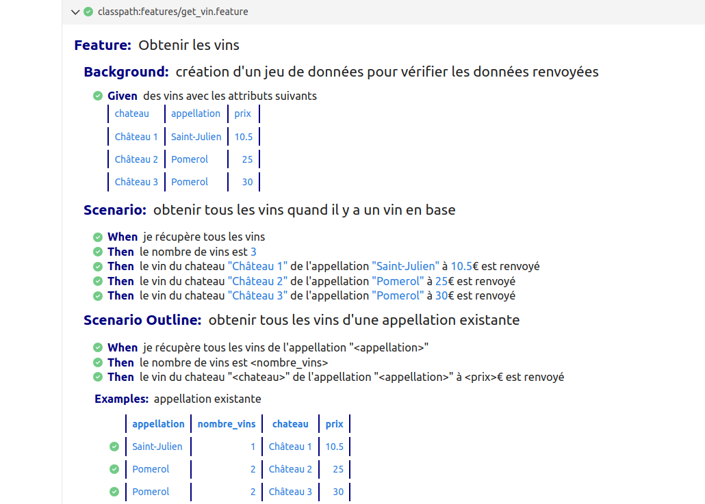

## Principes

- Framework de tests pour l'implémentation de scénarios **BDD** (*Behavior-Driven Development*).
- Utilisation du langage **Gherkin**, proche du langage humain et lisible par les non-informaticiens, pour spécifier les comportements attendus.
- Écriture d'un code de **glue** en Java pour relier les étapes Gherkin au code testé.
- Utilisable aussi bien pour des **tests unitaires** que pour des **tests d'intégration** Spring Boot.
- Fournit une documentation vivante et toujours à jour (**living documentation**) grâce aux rapports d'exécution.

## Living Documentation



## Tests unitaires avec Cucumber

### Bibliothèques

```xml title="pom.xml"
<properties>
    <cucumber.version>8.1.0</cucumber.version>
</properties>

<dependencies>
    <dependency>
        <groupId>org.junit.platform</groupId>
        <artifactId>junit-platform-suite</artifactId>
        <scope>test</scope>
    </dependency>
    <dependency>
        <groupId>io.cucumber</groupId>
        <artifactId>cucumber-java8</artifactId>
        <version>${cucumber.version}</version>
        <scope>test</scope>
    </dependency>
    <dependency>
        <groupId>io.cucumber</groupId>
        <artifactId>cucumber-junit-platform-engine</artifactId>
        <version>${cucumber.version}</version>
        <scope>test</scope>
    </dependency>
</dependencies>
```

### Configuration du runner JUnit

```java title="CucumberRunnerTest.java"
import static io.cucumber.junit.platform.engine.Constants.*;

@Suite
@IncludeEngines("cucumber")
@SelectPackages("features")
@ConfigurationParameter(key = GLUE_PROPERTY_NAME, value = "fr.insee.formationapirest.unittests")
@ConfigurationParameter(key = PLUGIN_PROPERTY_NAME, value = "pretty, html:target/rapport-cucumber-unit-tests.html")
public class CucumberRunnerTest {
}
```

### Écriture d'une première feature et de sa glue

```gherkin title="vins.feature"
Feature: Obtenir les vins

    Scenario: obtenir tous les vins quand il y en a 3 en base
        Given des vins avec les attributs suivants
            | chateau   | appellation  | prix |
            | Château 1 | Saint-Julien | 10.5 |
            | Château 2 | Pomerol      | 25   |
            | Château 3 | Pomerol      | 30   |
        When je récupère tous les vins
        Then le nombre de vins est 3
```

```java title="VinGlue.java"
public class VinGlue implements En {
    private VinRepoMock vinRepository;
    private VinService vinService;
    private List<Vin> vins;

    public VinGlue() {
        Before(() -> {
            vinRepository = new VinRepoMock();
            vinService = new VinService(vinRepository);
        });

        Given("des vins avec les attributs suivants", (DataTable dataTable) -> {
            List<Vin> toSave = dataTable.asMaps().stream().map(this::transformMapToVin).toList();
            toSave.forEach(vinRepository::save);
        });

        When("je récupère tous les vins", () -> {
            vins = vinService.findAll(null);
        });

        Then("le nombre de vins est {int}", (Integer nbExpected) -> {
            assertThat(vins).hasSize(nbExpected);
        });
    }

    private Vin transformMapToVin(Map<String, String> line) {
        return Vin.builder()
            .chateau(line.get("chateau"))
            .appellation(line.get("appellation"))
            .prix(Double.valueOf(line.get("prix")))
            .build();
    }
}
```

```java title="VinRepoMock.java"
public class VinRepoMock implements VinRepository {

    private final List<Vin> vins = new ArrayList<>();

    @Override
    public List<Vin> findAll() {
        return this.vins;
    }

    @Override
    public List<Vin> findByAppellation(String app) {
        return this.vins.stream().filter(v -> v.getAppellation().equals(app)).toList();
    }

    @Override
    public Vin save(Vin vin) {
        vins.add(vin);
        return vin;
    }
}
```

### Paramétrer une étape (`{string}`)

```gherkin
Scenario: obtenir tous les vins d'une appellation
    Given des vins avec les attributs suivants
        | chateau   | appellation  | prix |
        | Château 1 | Saint-Julien | 10.5 |
        | Château 2 | Pomerol      | 25   |
        | Château 3 | Pomerol      | 30   |
    When je récupère tous les vins de l'appellation "Pomerol"
    Then le nombre de vins est 2
```

```java
When("je récupère tous les vins de l'appellation {string}", (String appellation) -> {
    vins = vinService.findAll(appellation);
});
```

### Alternative : injection de dépendances avec `cucumber-spring`

Il est possible d'injecter des beans de test (ex. un repository en mémoire) dans les classes de glue via Spring (voir l'[exemple de Michael Azerhad](https://github.com/mica16/BDD-TDD-Demo/tree/part3)).

Ajoutez la dépendance `cucumber-spring` :

```xml title="pom.xml"
<dependency>
    <groupId>io.cucumber</groupId>
    <artifactId>cucumber-spring</artifactId>
    <version>${cucumber.version}</version>
    <scope>test</scope>
</dependency>
```

Déclarez vos beans de test avec le scope `cucumber-glue` (réinitialisés entre chaque scénario) puis reliez le contexte à Cucumber via `@CucumberContextConfiguration` :

```java title="RepositoriesConfiguration.java"
@Configuration
public class RepositoriesConfiguration {

    @Bean
    @Scope("cucumber-glue")
    public VinRepoMock vinRepository() {
        return new VinRepoMock();
    }
}
```

```java title="ContextConfigurationTest.java"
import org.springframework.test.context.ContextConfiguration;

@ContextConfiguration(classes = {
    RepositoriesConfiguration.class
})
@CucumberContextConfiguration
class ContextConfigurationTest {
}
```

Le repository est alors injecté par constructeur dans la classe de glue :

```java title="VinGlue.java"
public class VinGlue implements En {
    private VinService vinService;
    private List<Vin> vins;

    public VinGlue(VinRepoMock vinRepository) {
        Before(() -> {
            vinService = new VinService(vinRepository);
        });
        ...
    }
}
```

## Tests d'intégration avec Spring Boot

### Configuration du contexte et du runner `*IT`

Contrairement aux tests unitaires, le contexte démarre toute l'application Spring Boot avec `@SpringBootTest`. En Cucumber, une seule classe porte `@CucumberContextConfiguration` et `@SpringBootTest` :

```java title="ContextConfigurationIT.java"
@SpringBootTest
@AutoConfigureMockMvc
@TestPropertySource(properties = {
    "spring.datasource.driver-class-name=org.h2.Driver",
    "spring.datasource.url=jdbc:h2:mem:testdb"
})
@CucumberContextConfiguration
public class ContextConfigurationIT {
}
```

```java title="CucumberRunnerIT.java"
import static io.cucumber.junit.platform.engine.Constants.*;

@Suite
@IncludeEngines("cucumber")
@SelectPackages("features")
@ConfigurationParameter(key = GLUE_PROPERTY_NAME, value = "fr.insee.formationapirest.integrationtests")
@ConfigurationParameter(key = PLUGIN_PROPERTY_NAME, value = "pretty, html:target/rapport-cucumber-it-tests.html")
public class CucumberRunnerIT {
}
```

### Préparer et nettoyer la base de données (`BddGlue`)

L'utilitaire [DatabaseManager.java](https://github.com/gaetan-varlet/formation-api-rest/blob/master/applications/application-serveur-2-springboot/src/test/java/fr/insee/formationapirest/integrationtests/utils/DatabaseManager.java) fournit deux opérations réutilisables entre chaque scénario :

- `void insertInTable(String nomSchema, String nomTable, List<Map<String, String>> data)` pour insérer un jeu de données depuis un `DataTable`.
- `void clearDatabase()` pour réinitialiser la base.

```java title="BddGlue.java"
public class BddGlue implements En {

    private static final String PUBLIC = "public";

    public BddGlue(DatabaseManager databaseManager) {
        Before(databaseManager::clearDatabase);

        Given("les vins", (DataTable dataTable) -> {
            List<Map<String, String>> dataToSave = dataTableToListMaps(dataTable);
            databaseManager.insertInTable(PUBLIC, "vin", dataToSave);
        });
    }

    public static List<Map<String, String>> dataTableToListMaps(DataTable dataTable) {
        List<Map<String, String>> dataAsMaps = new ArrayList<>();
        for (Map<String, String> row : dataTable.asMaps()) {
            Map<String, String> normalized = new HashMap<>(row);
            normalized.replaceAll((_, value) -> normalizeCell(value));
            dataAsMaps.add(normalized);
        }
        return dataAsMaps;
    }

    private static String normalizeCell(String value) {
        if ("[empty]".equals(value)) {
            return "";
        }
        if ("[blank]".equals(value)) {
            return " ";
        }
        return value;
    }
}
```

### Tests de lecture et de création

```gherkin title="get-vins.feature"
Feature: Obtenir les vins

    Background: création d'un jeu de données pour vérifier les données renvoyées
        Given les vins
            | chateau   | appellation  | prix |
            | Château 1 | Saint-Julien | 10.5 |
            | Château 2 | Pomerol      | 25   |
            | Château 3 | Pomerol      | 30   |

    Scenario: obtenir tous les vins quand il y a 3 vins en base
        When je récupère tous les vins
        Then le nombre de vins est 3
        Then le vin du chateau "Château 1" de l'appellation "Saint-Julien" à 10.5€ est renvoyé
        Then le vin du chateau "Château 2" de l'appellation "Pomerol" à 25€ est renvoyé
        Then le vin du chateau "Château 3" de l'appellation "Pomerol" à 30€ est renvoyé

    Scenario Outline: obtenir tous les vins d'une appellation existante
        When je récupère tous les vins de l'appellation "<appellation>"
        Then le nombre de vins est <nombre_vins>
        Then le vin du chateau "<chateau>" de l'appellation "<appellation>" à <prix>€ est renvoyé
        Examples: appellation existante
            | appellation  | nombre_vins | chateau   | prix |
            | Saint-Julien | 1           | Château 1 | 10.5 |
            | Pomerol      | 2           | Château 2 | 25   |
```

```gherkin title="create-vins.feature"
Feature: Créer des vins

    Scenario Outline: créer un vin avec des informations justes
        Given je veux créer un vin avec les attributs suivants
            | chateau   | appellation   | prix   |
            | <chateau> | <appellation> | <prix> |
        When je récupère tous les vins
        Then le nombre de vins est 1
        Then le vin du chateau "<chateau>" de l'appellation "<appellation>" à <prix>€ est renvoyé
        Examples:
            | chateau   | appellation | prix |
            | Chateau 1 | app1        | 5    |
            | Chateau 2 | toto        | 1.23 |

    Scenario Outline: créer un vin avec des informations erronées (<testCase>)
        Given je veux créer un vin avec les attributs suivants
            | chateau   | appellation   | prix   |
            | <chateau> | <appellation> | <prix> |
        When je récupère tous les vins
        Then le nombre de vins est 0
        Then j'ai le message d'erreur suivant "<message>"
        Examples:
            | testCase                     | chateau                                             | appellation | prix | message                                                                                                                                   |
            | nom de château trop long     | 123456789012345678901234567890123456789012345678901 | toto        | 5    | le vin renseigné (Vin(id=null, chateau=123456789012345678901234567890123456789012345678901, appellation=toto, prix=5.0)) n'est pas valide |
            | nom de château non renseigné |                                                     | toto        | 5    | le vin renseigné (Vin(id=null, chateau=null, appellation=toto, prix=5.0)) n'est pas valide                                                |
```

```java title="VinGlue.java"
@Slf4j
public class VinGlue implements En {
    private List<Vin> vins;
    private String exception;

    public VinGlue(VinService vinService) {
        Given("je veux créer un vin avec les attributs suivants", (DataTable dataTable) -> {
            try {
                List<Map<String, String>> line = dataTable.asMaps();
                vinService.add(transformMapToVin(line.getFirst()));
                exception = null;
            } catch (Exception e) {
                log.debug("ERREUR lors de la recherche d'anomalies", e);
                exception = e.getMessage();
            }
        });

        When("je récupère tous les vins", () -> {
            vins = vinService.findAll(null);
        });

        When("je récupère tous les vins de l'appellation {string}", (String app) -> {
            vins = vinService.findAll(app);
        });

        Then("le nombre de vins est {int}", (Integer nbExpected) -> {
            assertThat(vins).hasSize(nbExpected);
        });

        Then("le vin du chateau {string} de l'appellation {string} à {double}€ est renvoyé",
                (String chateau, String appellation, Double prix) -> {
                    List<Vin> vinsFiltres = vins.stream()
                        .filter(v -> v.getChateau().equals(chateau) && v.getAppellation().equals(appellation))
                        .toList();
                    assertThat(vinsFiltres).hasSize(1);
                    assertThat(vinsFiltres.getFirst().getPrix()).isEqualTo(prix);
                });

        Then("j'ai le message d'erreur suivant {string}", (String expectedError) -> {
            assertThat(exception).isEqualTo(expectedError);
        });
    }
}
```

### Contrôle des droits d'accès

Ajoutez `spring-security-test` pour injecter une authentification simulée via des tags Gherkin (`@WithRoleToto`, `@WithRoleAdmin`) :

```xml title="pom.xml"
<dependency>
    <groupId>org.springframework.security</groupId>
    <artifactId>spring-security-test</artifactId>
    <scope>test</scope>
</dependency>
```

```gherkin title="security.feature"
Feature: Tester les droits d'accès

    Scenario: impossibilité d'accéder au endpoint /hello-secured sans jeton
        When je fais une requête HTTP en GET sur l'url "/hello-secured"
        Then j'obtiens un code retour HTTP 401

    @WithRoleToto
    Scenario: impossibilité d'accéder au endpoint /hello-secured avec un mauvais rôle
        When je fais une requête HTTP en GET sur l'url "/hello-secured"
        Then j'obtiens un code retour HTTP 403

    @WithRoleAdmin
    Scenario: possibilité d'accéder au endpoint /hello-secured avec le rôle admin
        When je fais une requête HTTP en GET sur l'url "/hello-secured"
        Then j'obtiens un code retour HTTP 200
```

```java title="SecurityGlue.java"
public class SecurityGlue implements En {
    private static final String ROLE_PREFIX = "ROLE_";
    private ResultActions result;
    private Authentication currentAuthentication;

    public SecurityGlue(MockMvc mockMvc) {
        After(() -> {
            this.currentAuthentication = null;
            SecurityContextHolder.clearContext();
        });

        Before("@WithRoleAdmin", () -> {
            this.currentAuthentication = buildAuth("admin", "ADMIN_APPLI");
            SecurityContextHolder.getContext().setAuthentication(this.currentAuthentication);
        });

        Before("@WithRoleToto", () -> {
            this.currentAuthentication = buildAuth("toto", "TOTO");
            SecurityContextHolder.getContext().setAuthentication(this.currentAuthentication);
        });

        When("je fais une requête HTTP en GET sur l'url {string}", (String url) -> {
            MockHttpServletRequestBuilder requestBuilder = MockMvcRequestBuilders.get(url);
            if (this.currentAuthentication != null) {
                requestBuilder.with(authentication(this.currentAuthentication));
            }
            result = mockMvc.perform(requestBuilder);
        });

        Then("j'obtiens un code retour HTTP {int}", (Integer codeReponse) -> {
            result.andExpect(MockMvcResultMatchers.status().is(codeReponse));
        });
    }

    private Authentication buildAuth(String username, String role) {
        return new UsernamePasswordAuthenticationToken(
            username,
            "N/A",
            AuthorityUtils.createAuthorityList(ROLE_PREFIX + role)
        );
    }
}
```
