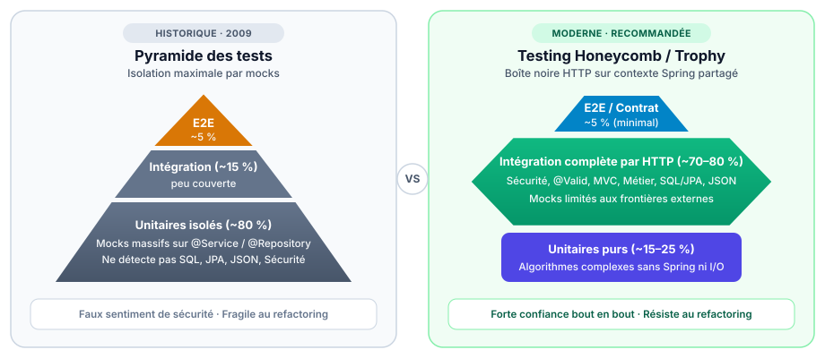
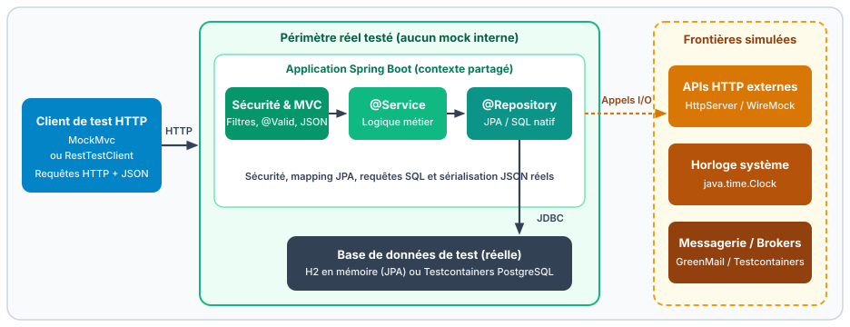

## Pourquoi tester ?

Au-delà de la conformité fonctionnelle, de l'ergonomie (UI/UX, accessibilité), de la performance, de la fiabilité et de la sécurité, une application réussie doit répondre dans la durée à deux exigences souvent sous-estimées :

- **Fonctionner en rythme courant sans intervention de l'équipe informatique** (utilisateurs autonomes en production).
- **Conserver un coût de MCO / MCS faible** (*Maintien en Condition Opérationnelle et de Sécurité*).

Or deux constats reviennent sur de nombreux projets :

1. **Un temps important est absorbé par le suivi de production et la correction de bugs**, au détriment des nouvelles fonctionnalités. Concevoir l'application pour rendre les utilisateurs autonomes et sécuriser les comportements libère ce temps de développement.
2. **Les montées de version des bibliothèques sont repoussées voire abandonnées**, par crainte de casser l'existant.

:::note[Idée reçue : « Écrire des tests est inutile, la MOA fait déjà une recette — et en plus ça prend du temps »]
La recette manuelle valide un instant T, pas les modifications du lendemain. Investir dans des tests automatisés améliore directement la **productivité future du SI** :

- **Automatiser les tâches répétitives :** un informaticien évite de refaire sans cesse les mêmes vérifications à la main à chaque livraison.
- **Évoluer et refactorer sans crainte :** les tests détectent immédiatement les régressions dans la base de code.
- **Faciliter les montées de version (MCS) :** si la suite de tests automatisés passe après une mise à jour de dépendance, la vérification manuelle devient réduite et ciblée — voire nulle si la couverture de tests est vraiment complète.
:::

 avec et sans tests automatisés")

## Typologie des tests

Avant de définir une stratégie de tests, il est indispensable de distinguer les quatre niveaux de tests selon leur périmètre d'isolation.

### Test unitaire

Vérifie le comportement d'une unité de logique métier (une méthode ou une classe) **en mémoire, sans framework ni entrées/sorties** (pas de base de données, pas de réseau, pas de système de fichiers).

- **Test unitaire isolé :** Toutes les dépendances internes de la classe testée sont remplacées par des doublures (*mocks* ou *stubs*).
- **Test unitaire élargi :** La classe testée collabore avec de vrais objets métier en mémoire (objets-valeurs, validateurs purs), toujours sans I/O ni contexte Spring.

:::tip[Exemple]
Tester une règle de calcul sur des cas limites via un test paramétré (exécution en quelques millisecondes).
:::

### Test d'intégration

Vérifie le fonctionnement de l'application avec son infrastructure technique réelle (contexte Spring, sécurité, sérialisation JSON, requêtes SQL/JPA). Seuls les systèmes externes hors du périmètre du service (APIs tierces, serveur mail, horloge système) sont simulés aux frontières. Ce niveau regroupe deux périmètres :

- **Test d'intégration de tranche (*Slice Test*) :** Charge uniquement une couche technique Spring (`@WebMvcTest` pour la couche web, `@DataJpaTest` pour la persistance JPA).
- **Test d'intégration complet (ou *Test de composant*) :** Démarre l'application complète et l'interroge par son point d'entrée externe (requête HTTP), connectée à une base de données de test. C'est la forme de référence dans les architectures orientées API/microservices.

:::tip[Exemple]
Envoyer une requête `POST /api/exclusions` avec un corps JSON et un rôle utilisateur, puis vérifier le statut HTTP `201`, la structure du JSON retourné et l'enregistrement en base de données.
:::

### Test de contrat

Vérifie uniquement la compatibilité du **format d'échange** (schéma JSON, noms et types des champs, codes HTTP) entre un **Consommateur** (client) et un **Fournisseur** (API), sans déployer les deux applications simultanément (outils : *Pact*, *Spring Cloud Contract*).

:::tip[Exemple]
Le front-end (consommateur) génère un fichier contrat stipulant qu'il lit les champs `hostname` (string) et `critique` (boolean) sur `GET /api/serveurs`. Ce contrat est rejoué automatiquement dans la CI du back-end (fournisseur) pour garantir qu'aucun renommage de champ ne cassera le front-end.
:::

### Test de bout en bout (*End-to-End* / *E2E*)

Vérifie un parcours utilisateur complet sur un environnement déployé réunissant tous les composants réels (navigateur, front-end, API back-end, base de données, fournisseur d'identité, services partenaires).

:::tip[Exemple]
Piloter un navigateur via Playwright pour s'authentifier sur un serveur OIDC, saisir un formulaire dans l'interface web et vérifier la mise à jour des données affichées.
:::

## Stratégie historique vs Stratégies modernes

### La stratégie historique : la Pyramide des tests (Mike Cohn, 2009)

Conçue à une époque où le démarrage d'un serveur d'applications prenait plusieurs minutes, elle préconise une isolation maximale : **~80 % de tests unitaires isolés (mockés), 15 % de tests d'intégration, 5 % de tests E2E**.

**Limites sur une API Spring Boot orientée données / orchestration :**

- **Faux sentiment de sécurité :** Une couverture de code élevée obtenue avec des mocks ne détecte ni les requêtes JPQL/SQL invalides, ni les erreurs de mapping JPA, ni les oublis de `@Transactional`, ni les régressions de sérialisation JSON ou de règles de sécurité (`@RolesAllowed`).
- **Couplage fort à l'implémentation :** Les tests reproduisent le câblage interne des classes. Renommer ou découper un service oblige à réécrire les configurations de mocks.

### Les stratégies modernes : *Testing Honeycomb* (Spotify) et *Testing Trophy* (Kent C. Dodds)

Grâce au démarrage rapide des conteneurs modernes et à la mise en cache du contexte Spring entre les tests, l'effort se concentre sur le **test d'intégration complet (composant)** traité comme une boîte noire :

1. **Majorité de tests d'intégration par HTTP :** L'application Spring complète démarre une seule fois pour toute la suite de tests. Les scénarios passent par la couche HTTP pour valider en une passe la sécurité, le binding Spring MVC, la logique métier, la persistance SQL et la sérialisation JSON. Les mocks sont strictement limités aux **frontières externes** (APIs tierces, horloge).
2. **Base ciblée de tests unitaires purs :** Réservée aux algorithmes complexes sans dépendance Spring ni base de données (moteurs de règles, calculs), exécutés sans démarrer le contexte applicatif.
3. **Sommet minimal de tests E2E / Contrat :** Limité aux parcours critiques déployés ou aux interfaces entre équipes indépendantes.

### Tableau comparatif

| Critère | Stratégie historique (Pyramide) | Stratégies modernes (*Honeycomb* / *Trophy*) |
|---|---|---|
| **Volume principal** | Tests unitaires isolés (~80 %) | Tests d'intégration complets par HTTP |
| **Usage des mocks** | Massif sur les dépendances internes (`@Repository`, `@Service`) | Uniquement aux **frontières externes** (APIs tierces, horloge) |
| **Point d'entrée testé** | Méthodes Java internes | Contrat externe (**requêtes HTTP / payloads JSON**) |
| **Garanties apportées** | Logique isolée d'une classe | Chaîne complète : sécurité, validation, Spring MVC, SQL/JPA, JSON |
| **Résistance au refactoring** | Faible (le découpage interne casse les mocks) | Élevée (transparent tant que le contrat HTTP est respecté) |

## Règles d'arbitrage et outillage

### Quand écrire quel test ? (Approche pragmatique)

- **Test d'intégration HTTP par défaut :** Pour tout cas d'usage métier, contrôle d'accès (`401`/`403`), erreur de validation (`400`), sérialisation JSON et opération en base de données.
- **Arbitrage « tout en intégration » vs « unitaire + intégration » sur les règles de calcul :**
  - **Tout regrouper en intégration (via un test paramétré ou un `Scenario Outline`) :** Lorsque le harnais d'intégration est rapide (contexte Spring partagé), que la préparation des données est légère (quelques lignes en base) et que le nombre de cas reste raisonnable (moins de 15–20 cas). Cela évite de maintenir deux fichiers de tests pour la même fonctionnalité.
  - **Séparer en 1 test d'intégration nominal (pour le câblage) + N tests unitaires purs (pour l'algorithme) :** Uniquement lorsque la combinatoire est élevée (parseurs complexes, regex, matrices de dates) ou que la préparation du contexte d'intégration (multiples tables liées, bouchons HTTP) noie l'intention métier et ralentit l'exécution unitaire dans l'IDE.

:::caution[À éviter]
Appeler directement les méthodes Java des `@RestController` dans les tests d'intégration. Cela contourne les filtres de sécurité, la validation `@Valid`, le binding `@RequestParam` et la sérialisation Jackson.
:::

### Choix des outils et simulation des frontières

- **Privilégier un outil unique (ou quasi unique) :** Plusieurs choix sont valides (tout-JUnit, tout-Cucumber, etc.). Utiliser le même outil pour les tests unitaires et les tests d'intégration homogénéise l'écriture des tests et évite de multiplier les styles d'assertions, en veillant simplement à ne pas démarrer le contexte Spring sur les tests unitaires.
- **Simulation des systèmes externes aux frontières :** Plutôt que de mocker les services clients internes avec `@MockitoBean` (ce qui court-circuite les clients HTTP et la désérialisation), simuler les dépendances au niveau du protocole :
  - **[APIs HTTP externes](/formation-api-rest/tests/api-externes/) :** Démarrer un serveur HTTP local sur un port de test (ex. `HttpServer` du JDK ou **WireMock**) et y rediriger les URLs configurées.
  - **[Horloge système](/formation-api-rest/tests/horloge-temps/) :** Injecter `java.time.Clock` et le remplacer en test (horloge fixe ou mutable `@Primary`) pour garder des tests déterministes sans redémarrer le contexte Spring.
  - **Messagerie et autres infrastructures tierces :** Les envois d'e-mails, files de messages ou stockages externes doivent également être simulés ou isolés aux frontières pour préserver l'autonomie des tests *(non détaillé dans cette formation)*.
- **[Base de données de test](/formation-api-rest/tests/bdd-tests/) :** Une base en mémoire rapide (H2) convient tant que l'accès aux données repose sur du JPA standard. Basculer sur un vrai moteur PostgreSQL en test (ex. **Testcontainers** ou **Zonky**) dès l'introduction de requêtes SQL natives (`nativeQuery = true`) ou de types spécifiques au SGBD de production.

## Spécificités en développement assisté par agents (IA)

:::note[Pourquoi cette stratégie compte encore plus avec l'IA]
En développement agentique, tester l'application en **boîte noire par HTTP** devient un garde-fou indispensable.
:::

- **Un filet de sécurité objectif contre les angles morts de l'IA :** Un agent de code génère rapidement une implémentation crédible en apparence, mais peut introduire une régression sur un mapping JPA, une requête SQL, une sérialisation JSON ou une règle de sécurité. S'il écrit des tests unitaires isolés avec des mocks, il risque de mocker ses propres hypothèses fausses et de produire des tests complaisants qui passent au vert. Le test d'intégration HTTP vérifie le comportement réel de bout en bout (de la requête jusqu'à la base de données), ce qui réduit fortement le risque de valider une implémentation défaillante.
- **Garder la maîtrise du contrat sans ralentir le flux :** Laisser l'agent générer le code et les tests à partir d'une liste claire des cas attendus dans le prompt (cas nominaux, erreurs `400`/`403`/`404`), puis concentrer la revue de code sur les assertions générées et sur toute modification apportée aux tests existants.
- **Préserver une boucle de vérification rapide et lisible :** Un agent valide son travail par itérations successives en relançant fréquemment les tests. Maintenir un contexte Spring unique partagé, exécuter de manière ciblée les tests modifiés et isoler les algorithmes complexes dans des tests unitaires sans framework (retour sous la seconde, traces d'erreur concises) garantit des cycles de correction courts et efficaces.
